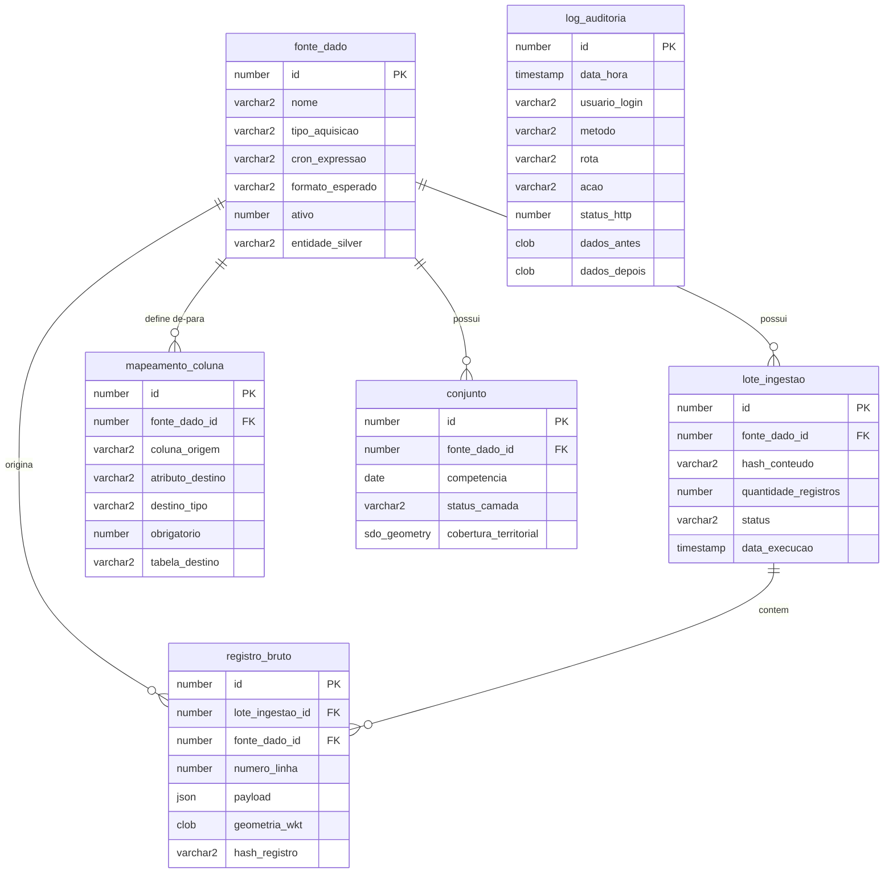
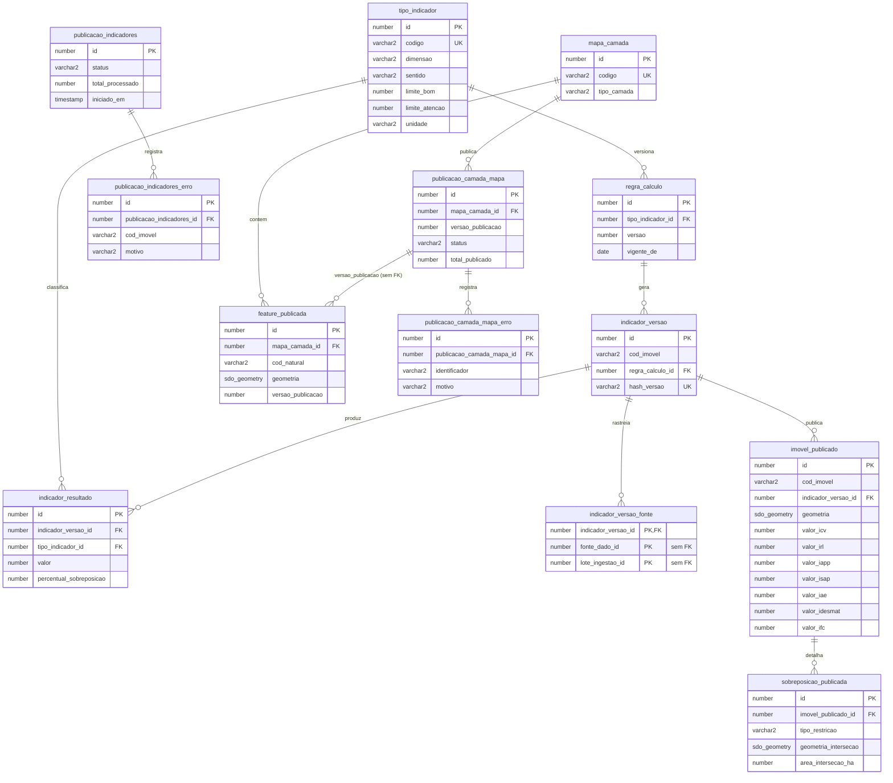
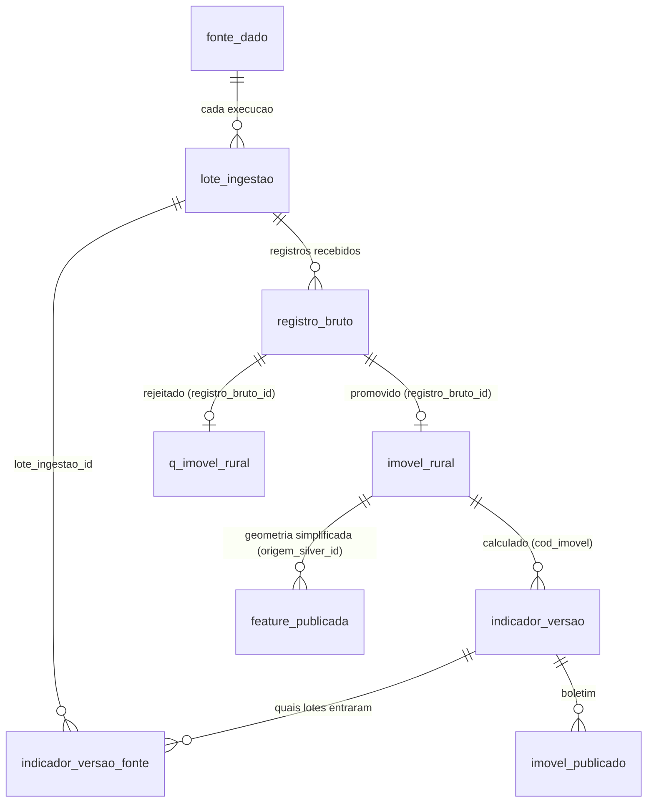

# Dicionário de Dados Interno — DataGis

---

## Sumário

1. [Schema `CONTROLE`](#1-schema-controle) — fontes, lotes, de-para, conjuntos e log de auditoria (5 tabelas)
2. [Schema `BRONZE`](#2-schema-bronze) — dado bruto, schema-on-read (1 tabela)
3. [Schema `SILVER`](#3-schema-silver) — entidades canônicas (27 tabelas: 16 de referência + 11 de fato e ponte) + 1 view
4. [Schema `QUARENTENA`](#4-schema-quarentena) — registros reprovados (12 tabelas)
5. [Schema `GOLD`](#5-schema-gold) — indicadores, mapa, detalhe publicado e controle de execução (13 tabelas) + 8 views + objetos PL/SQL
6. [Schemas `QUARTZ` e `BATCH`](#6-schemas-quartz-e-batch) — infraestrutura de frameworks
7. [Convenções gerais](#7-convenções-gerais)
8. [Modelo Lógico Relacional (Mermaid)](#8-modelo-lógico-relacional-mermaid)
9. [Histórico de mudanças desde a versão anterior deste documento](#9-histórico-de-mudanças-desde-a-versão-anterior-deste-documento)

---

## 1. Schema `CONTROLE`

Schema transversal do projeto: cadastro de fontes de dados, lotes de ingestão, de-para
configurável Bronze→Silver, conjuntos de dados e log de auditoria. O usuário da aplicação
(`CONTROLE`, o `APP_USER`) é o dono deste schema e tem privilégios `ANY` para gerenciar os
demais pelo Flyway. A tabela `flyway_schema_history` (histórico das migrations, mantida
pelo próprio Flyway) também fica aqui e não é documentada.

### 1.1. Tabela `fonte_dado`

Catálogo de todas as fontes de dados externas (18 cadastradas, ver §1.6). Uma linha por fonte, com tudo o que a ingestão genérica por formato precisa para buscar e converter os dados sem código novo, além do agendamento e do resultado da última execução.

| Atributo | Tipo de Dado | Restrição / Chave | Descrição |
| :--- | :--- | :--- | :--- |
| `id` | NUMBER | PK, Identity | Chave primária. |
| `nome` | VARCHAR2(200) | NOT NULL | Nome de exibição da fonte (ex.: "CAR - Imóveis (PR)"). |
| `orgao` | VARCHAR2(200) | NULL | Órgão responsável pela fonte (ex.: "SFB/SICAR"). |
| `tipo_aquisicao` | VARCHAR2(20) | NOT NULL | Como o dado é obtido: `UPLOAD_MANUAL` \| `API_REST` \| `DOWNLOAD_URL`. |
| `url_origem` | VARCHAR2(2000) | NULL | URL final de consulta, já com todo filtro resolvido (`CQL_FILTER`, `outSR`, `bbox` etc.). Nula para fontes `UPLOAD_MANUAL`. |
| `cron_expressao` | VARCHAR2(100) | NULL | Expressão cron do Quartz (ex.: `0 0 3 * * ?`). Vazia = sem agendamento, só execução manual. Salvar a fonte cria, atualiza ou remove o agendamento na hora. O horário vale no fuso de Brasília (`app.agendamento.fuso`). |
| `formato_esperado` | VARCHAR2(30) | NULL | Formato do dado de origem: `CSV` \| `GEOJSON` \| `SHAPEFILE` \| `JSON`. |
| `ativo` | NUMBER(1) | NOT NULL, DEFAULT 1 | Fonte habilitada para execução (0/1, mapeado em Java com `NumericBooleanConverter`). |
| `ultima_execucao_em` | TIMESTAMP | NULL | Data/hora da última execução de ingestão (UTC). |
| `proxima_execucao_em` | TIMESTAMP | NULL | Próxima execução agendada, lida do trigger do Quartz. Nula quando a fonte não tem agendamento. Gravada em UTC, como as demais datas do sistema. |
| `data_add` | TIMESTAMP | NOT NULL, DEFAULT SYSTIMESTAMP | Data de cadastro da fonte. |
| `campo_geometria_lat` | VARCHAR2(100) | NULL | Nome do campo de latitude, só para fontes CSV com coordenada (ex.: focos de calor). |
| `campo_geometria_lon` | VARCHAR2(100) | NULL | Nome do campo de longitude, mesmo caso acima. |
| `entidade_silver` | VARCHAR2(40) | NULL | Tabela da Silver de destino, em minúsculo: `municipio`, `bioma`, `imovel_rural`, `app_declarada`, `reserva_legal`, `vegetacao_nativa_declarada`, `area_protegida`, `embargo_ambiental`, `auto_infracao`, `desmatamento` ou `foco_calor`. Nula enquanto a fonte só tiver Bronze. Sem ela a ingestão é bloqueada. |
| `caminho_arquivo_upload` | VARCHAR2(500) | NULL | Endereço (devolvido por `ArmazenamentoArquivoBruto`) do último arquivo enviado, para fontes `UPLOAD_MANUAL`. |
| `ultima_duracao_ms` | NUMBER | NULL | Duração da última execução, em milissegundos. |
| `ultimo_status_execucao` | VARCHAR2(20) | NULL | `SUCESSO` \| `ERRO` (nulo = nunca executou). |
| `ultimo_erro_mensagem` | VARCHAR2(2000) | NULL | Mensagem de erro, só preenchida se `ultimo_status_execucao = ERRO`. |
| `separador_csv` | VARCHAR2(5) | NOT NULL, DEFAULT ',' | Caractere separador de campo para fontes CSV (`,`, `;`, `\|` etc. — variam entre provedores). |

**Grants relacionados:** `GRANT REFERENCES ON fonte_dado TO bronze` (FK cross-schema não é coberta por `CREATE ANY TABLE` — ver CLAUDE.md §2.1).

### 1.2. Tabela `lote_ingestao`

Registra cada execução de ingestão (um "lote" por chamada ou upload), com o hash do conteúdo recebido para detectar que a fonte não mudou desde a última vez. O `status` acompanha o lote até a Gold.

| Atributo | Tipo de Dado | Restrição / Chave | Descrição |
| :--- | :--- | :--- | :--- |
| `id` | NUMBER | PK, Identity | Chave primária. |
| `fonte_dado_id` | NUMBER | NOT NULL, FK `fonte_dado(id)` | Fonte que originou o lote. |
| `origem_referencia` | VARCHAR2(1000) | NULL | URL da API chamada, ou nome do arquivo do upload. |
| `hash_conteudo` | VARCHAR2(64) | NULL | Hash SHA-256 do conteúdo relevante recebido (não do envelope inteiro — evita falso positivo de "mudou" por campo de timestamp da resposta). |
| `quantidade_registros` | NUMBER | NULL | Quantidade de registros brutos gravados neste lote. |
| `status` | VARCHAR2(30) | NOT NULL, DEFAULT 'CONCLUIDO' | `EM_PROCESSAMENTO` \| `CONCLUIDO` \| `SEM_MUDANCA` \| `RETIDO_QUARENTENA` \| `PROMOVIDO_SILVER` \| `PROMOVIDO_GOLD` \| `DESCARTADO`. |
| `data_execucao` | TIMESTAMP | NOT NULL, DEFAULT SYSTIMESTAMP | Data/hora do disparo da execução. |

**Grants relacionados:** `GRANT REFERENCES ON lote_ingestao TO bronze`.

### 1.3. Tabela `mapeamento_coluna`

De-para configurável campo a campo: qual coluna do payload bruto (Bronze) vira qual atributo canônico da Silver, e quais regras de validação se aplicam. É lida em tempo de execução pelo motor de validação (`OrquestradorValidacao`). Fonte nova do mesmo tema não exige migration, só linhas aqui. As 18 fontes nascem com o de-para completo (`V078`/`V079`).

| Atributo | Tipo de Dado | Restrição / Chave | Descrição |
| :--- | :--- | :--- | :--- |
| `id` | NUMBER | PK, Identity | Chave primária. |
| `fonte_dado_id` | NUMBER | NOT NULL, FK `fonte_dado(id)` | Fonte a que este mapeamento pertence. |
| `coluna_origem` | VARCHAR2(200) | NOT NULL | Chave no payload JSON do Bronze (ex.: `num_tad`). |
| `atributo_destino` | VARCHAR2(100) | NOT NULL | Coluna canônica de destino na Silver (ex.: `numero_termo`). |
| `destino_tipo` | VARCHAR2(20) | NOT NULL, CHECK IN ('COLUNA','JSON','GEOMETRIA') | Tipo de destino do valor transformado. |
| `tipo_dado` | VARCHAR2(30) | NULL | Como interpretar o valor de origem: `texto` \| `numero` \| `data_iso` \| `epoch_millis` \| `cpf_cnpj` \| `graus2_para_ha` \| `wkt` etc. |
| `obrigatorio` | NUMBER(1) | NOT NULL, DEFAULT 0 | Se 1, ausência/nulo do campo gera erro `CAMPO_OBRIGATORIO_AUSENTE`. Coluna obrigatória da Silver (NOT NULL) sem mapeamento bloqueia a ingestão da fonte. |
| `data_add` | TIMESTAMP | NOT NULL, DEFAULT SYSTIMESTAMP | Data de cadastro do mapeamento. |
| `valor_minimo` | NUMBER | NULL | Limite numérico inferior (ex.: `area_ha > 0`). Sem teto máximo. |
| `tabela_referencia` | VARCHAR2(60) | NULL | Tabela de referência da Silver para validação de domínio (ex.: `situacao_imovel`, `orgao`, `bioma`). |
| `referencia_entidade_silver` | VARCHAR2(60) | NULL | Entidade Silver para validação de integridade cruzada (ex.: `municipio`, para `cod_municipio_ibge`). |
| `validar_cpf_cnpj` | NUMBER(1) | NOT NULL, DEFAULT 0, CHECK IN (0,1) | Ativa validação algorítmica de CPF/CNPJ (módulo 11). |
| `validar_geometria` | NUMBER(1) | NOT NULL, DEFAULT 0, CHECK IN (0,1) | Ativa validação topológica (`IsValidOp`) e de tipo primitivo. |
| `validar_recorte_pr` | NUMBER(1) | NOT NULL, DEFAULT 0, CHECK IN (0,1) | Ativa checagem de coordenadas/polígono dentro dos limites do Paraná. |
| `impedir_regressao` | NUMBER(1) | NOT NULL, DEFAULT 1, CHECK IN (0,1) | Impede que um campo antes preenchido volte a `null` num lote mais novo. |
| `regras_extras` | JSON | NULL | Regras customizadas de fontes futuras que não justificam coluna DDL nova. |
| `tabela_destino` | VARCHAR2(60) | NULL | Tabela Silver de destino deste de-para: cópia da `entidade_silver` da fonte, gravada em cada linha para evitar join com `fonte_dado` (`V078`, com backfill). |

**Restrições e índices adicionais:**
* `UNIQUE uq_mapeamento_coluna (fonte_dado_id, coluna_origem, atributo_destino)`
* Índice `ix_mapeamento_coluna_destino (fonte_dado_id, tabela_destino)`
* Índice `ix_mapeamento_coluna_fonte (fonte_dado_id)`

### 1.4. Tabela `conjunto`

Associa uma fonte de dado a uma competência (período de referência) e um status de camada, com cobertura territorial opcional (`LIZARDS-8`). Não é conectada ao pipeline Bronze→Silver: o `status_camada` é informado no cadastro. A tela que usava esta tabela foi substituída pelo mapa (LIZARDS-35); o endpoint continua existindo.

| Atributo | Tipo de Dado | Restrição / Chave | Descrição |
| :--- | :--- | :--- | :--- |
| `id` | NUMBER(19) | PK, Identity | Chave primária. |
| `fonte_dado_id` | NUMBER(19) | NOT NULL, FK `fonte_dado(id)` | Fonte associada ao conjunto. |
| `competencia` | DATE | NOT NULL | Período de referência do conjunto de dados. |
| `status_camada` | VARCHAR2(50) | NOT NULL | `ATIVA` \| `INATIVA` \| `PROCESSANDO` \| `ERRO`. |
| `cobertura_territorial` | MDSYS.SDO_GEOMETRY | NULL | Geometria opcional de cobertura territorial do conjunto (SRID 4674). |

### 1.5. Tabela `log_auditoria`

Log de auditoria de toda ação que altera dado pela API (`V075`, LIZARDS-48; antes/depois na `V082`, LIZARDS-56). **Somente inserção** (RN025): a trigger `trg_log_auditoria_somente_insercao` recusa `UPDATE` e `DELETE` com `ORA-20025`. Gravado pelo `FiltroAuditoria`, dentro da cadeia do Spring Security, então tentativas negadas (401/403) também ficam registradas.

| Atributo | Tipo de Dado | Restrição / Chave | Descrição |
| :--- | :--- | :--- | :--- |
| `id` | NUMBER | PK, Identity | Chave primária. |
| `data_hora` | TIMESTAMP | NOT NULL, DEFAULT SYSTIMESTAMP | Data/hora da requisição (UTC). |
| `usuario_id` | VARCHAR2(64) | NULL | ID do usuário no Keycloak (claim `sub`, UUID). Nulo em requisição sem login. |
| `usuario_login` | VARCHAR2(200) | NULL | Login do usuário (`preferred_username`). |
| `perfis` | VARCHAR2(1000) | NULL | Perfis do usuário no momento da ação (roles `perfil-*`), separados por vírgula. |
| `metodo` | VARCHAR2(10) | NOT NULL | Método HTTP: `POST`, `PUT`, `PATCH` ou `DELETE`. Consultas (`GET`) não são registradas. |
| `rota` | VARCHAR2(1000) | NOT NULL | Caminho chamado, com os valores reais (ex.: `/api/admin/usuarios/1f2e...`). |
| `rota_padrao` | VARCHAR2(500) | NULL | Molde da rota (ex.: `/api/admin/usuarios/{id}`), usado para agrupar e descrever a ação. |
| `parametros` | VARCHAR2(2000) | NULL | Query string da requisição. O corpo nunca é gravado (senhas, uploads). |
| `acao` | VARCHAR2(200) | NULL | Descrição legível da ação (ex.: `Editar dados do usuario`), gerada por `DescricaoAcao`. |
| `status_http` | NUMBER(3) | NOT NULL | Status HTTP devolvido, inclusive 401/403: tentativa negada também fica registrada. |
| `sucesso` | NUMBER(1) | NOT NULL | 1 quando o status foi menor que 400; 0 caso contrário. |
| `duracao_ms` | NUMBER | NULL | Tempo de processamento da requisição, em milissegundos. |
| `ip_origem` | VARCHAR2(64) | NULL | IP de quem fez a requisição (`X-Forwarded-For`, quando houver proxy). |
| `dados_antes` | CLOB | IS JSON | JSON do registro antes da alteração (`V082`). Nulo em cadastro novo, em ação de processo (ingestão, liberação de lote, publicação) e em registros anteriores à V082. Senha nunca é gravada. |
| `dados_depois` | CLOB | IS JSON | JSON do registro depois da alteração (`V082`). Nulo em ação de processo e em registros anteriores à V082. |

**Restrições e índices adicionais:**
* Índice `ix_log_auditoria_data (data_hora)`
* Índice `ix_log_auditoria_login (usuario_login)`

**Trigger:** `trg_log_auditoria_somente_insercao` (`BEFORE UPDATE OR DELETE`) — lança `ORA-20025` em qualquer tentativa de alterar ou apagar uma linha.

### 1.6. Fontes cadastradas (`fonte_dado`)

Catálogo semeado pela `V003` (ordem de ingestão desejável: pré-requisitos primeiro, CLAUDE.md §9.35) e completado pelas migrations seguintes. Nenhuma fonte nasce com agendamento.

| ID | Fonte | Aquisição | Formato | Tabela Silver |
| :-- | :--- | :--- | :--- | :--- |
| 1 | IBGE - Malha Municipal (PR) | `API_REST` | `GEOJSON` | `municipio` |
| 2 | IBGE - Limites de biomas | `DOWNLOAD_URL` | `SHAPEFILE` | `bioma` |
| 3 | CAR - Imóveis (PR) | `API_REST` | `GEOJSON` | `imovel_rural` |
| 4 | IAT/PR - APP Total (CAR) | `API_REST` | `GEOJSON` | `app_declarada` |
| 5 | IAT/PR - Reserva Legal (CAR) | `API_REST` | `GEOJSON` | `reserva_legal` |
| 6 | IAT/PR - Vegetação Nativa (CAR) | `API_REST` | `GEOJSON` | `vegetacao_nativa_declarada` |
| 7 | ICMBio - Unidades de Conservação (PR) | `API_REST` | `GEOJSON` | `area_protegida` |
| 8 | IAT/PR - Terras Indígenas (FUNAI) | `API_REST` | `GEOJSON` | `area_protegida` |
| 9 | MMA - Unidades de Conservacao (CNUC nacional) | `DOWNLOAD_URL` | `SHAPEFILE` | `area_protegida` |
| 10 | SFB - Cadastro Nacional de Florestas Publicas (CNFP) | `DOWNLOAD_URL` | `SHAPEFILE` | `area_protegida` |
| 11 | IAT/PR - Embargos IBAMA | `API_REST` | `GEOJSON` | `embargo_ambiental` |
| 12 | IAT/PR - Embargos ICMBio | `API_REST` | `GEOJSON` | `embargo_ambiental` |
| 13 | IAT/PR - Autos de Infração IBAMA | `API_REST` | `GEOJSON` | `auto_infracao` |
| 14 | IAT/PR - Autos de Infração ICMBio | `API_REST` | `GEOJSON` | `auto_infracao` |
| 15 | INPE (PRODES) - Desmatamento Mata Atlântica (PR) | `API_REST` | `GEOJSON` | `desmatamento` |
| 16 | IAT/PR - Focos de Calor (INPE) | `API_REST` | `GEOJSON` | `foco_calor` |
| 17 | INPE (Queimadas) - Focos de calor, Brasil (mensal) | `DOWNLOAD_URL` | `CSV` | `foco_calor` |
| 18 | CAR - Imóveis (PR) via Shapefile (upload) | `UPLOAD_MANUAL` | `SHAPEFILE` | `imovel_rural` |

---

## 2. Schema `BRONZE`

Zona bruta: dado exatamente como recebido da fonte, sem tratamento. Desenho
**schema-on-read** — uma única tabela genérica guarda qualquer formato de origem como
JSON, em vez de uma tabela por fonte. A Bronze é **imutável**: correções feitas na
quarentena nunca alteram o registro bruto, e cada reingestão grava um lote novo.

### 2.1. Tabela `registro_bruto`

Uma linha por registro recebido de qualquer fonte, como veio.

| Atributo | Tipo de Dado | Restrição / Chave | Descrição |
| :--- | :--- | :--- | :--- |
| `id` | NUMBER | PK, Identity | Chave primária. |
| `lote_ingestao_id` | NUMBER | NOT NULL, FK `controle.lote_ingestao(id)` | Lote a que este registro pertence. |
| `fonte_dado_id` | NUMBER | NOT NULL, FK `controle.fonte_dado(id)` | Fonte de origem do registro. |
| `numero_linha` | NUMBER | NULL | Posição do registro no arquivo/resposta original (rastreabilidade). |
| `payload` | JSON | NOT NULL | O registro inteiro, com os nomes de coluna originais da fonte — sem tipagem, sem interpretação. |
| `geometria_wkt` | CLOB | NULL | Geometria em WKT, convertida mas **sem validar** nesta camada. |
| `hash_registro` | VARCHAR2(64) | NULL | Hash para ajudar a localizar duplicata depois. |
| `data_ingestao` | TIMESTAMP | NOT NULL, DEFAULT SYSTIMESTAMP | Data/hora de gravação do registro. |

**Observação:** `hash_registro` ainda não é preenchido pela ingestão (pendência registrada no CLAUDE.md §9.31); o hash do lote inteiro fica em `lote_ingestao.hash_conteudo`.

---

## 3. Schema `SILVER`

Entidades canônicas de domínio, organizadas **por fenômeno, não por fonte** — um embargo
do IBAMA e um do ICMBio caem na mesma `embargo_ambiental`. Todo domínio de negócio é FK
para uma tabela de referência semeada. Núcleo tipado + `atributos_origem JSON` para o que
é específico da fonte. Geometria em `MDSYS.SDO_GEOMETRY`, SRID 4674 (metadata na
`V013`). Toda tabela de fato carrega a linhagem (`fonte_dado_id`, `lote_ingestao_id`,
`registro_bruto_id`, cross-schema, sem FK física) + `hash_origem`. **Silver é
current-state** (upsert via `MERGE`), não histórico (SCD).

### 3.1. Tabelas de referência

São 16 tabelas de domínio. 13 seguem exatamente o mesmo padrão de colunas (abaixo, com
`orgao` como exemplo); `unidade_federativa`, `categoria_area_protegida` e `bioma` têm
colunas a mais e estão detalhadas nas seções 3.1.2 a 3.1.4.

#### 3.1.1. Padrão das tabelas de referência

| Atributo | Tipo de Dado | Restrição / Chave | Descrição |
| :--- | :--- | :--- | :--- |
| `id` | NUMBER | PK, Identity | Chave primária. |
| `codigo` | VARCHAR2(40) | NOT NULL, UNIQUE | Código do valor de domínio (ex.: `IBAMA`). |
| `descricao` | VARCHAR2(200) | NOT NULL | Descrição do valor. |
| `ativo` | NUMBER(1) | NOT NULL, DEFAULT 1 | Se o valor está em uso (só ativos são aceitos pelo `ValidadorDominio`). |
| `data_add` | TIMESTAMP | NOT NULL, DEFAULT SYSTIMESTAMP | Data de cadastro. |

O padrão vale para: `orgao`, `satelite`, `sensor`, `situacao_imovel`, `condicao_imovel`,
`tipo_imovel`, `tipo_area_protegida`, `tipo_area_embargo`, `tipo_auto_infracao`,
`tipo_infracao`, `tipo_pessoa` (com `codigo VARCHAR2(2)`), `status_auto_infracao` e
`classe_prodes`.

#### 3.1.2. Tabela `unidade_federativa`

| Atributo | Tipo de Dado | Restrição / Chave | Descrição |
| :--- | :--- | :--- | :--- |
| `id` | NUMBER | PK, Identity | Chave primária. |
| `codigo` | VARCHAR2(2) | NOT NULL, UNIQUE | Sigla da UF (ex.: `PR`). |
| `descricao` | VARCHAR2(60) | NOT NULL | Nome da UF. |
| `cod_ibge` | NUMBER(2) | NOT NULL, UNIQUE | Código IBGE da UF. |
| `regiao` | VARCHAR2(20) | NOT NULL | Região do país. |
| `ativo` | NUMBER(1) | NOT NULL, DEFAULT 1 | Se o valor está em uso. |
| `data_add` | TIMESTAMP | NOT NULL, DEFAULT SYSTIMESTAMP | Data de cadastro. |

#### 3.1.3. Tabela `categoria_area_protegida`

| Atributo | Tipo de Dado | Restrição / Chave | Descrição |
| :--- | :--- | :--- | :--- |
| `id` | NUMBER | PK, Identity | Chave primária. |
| `codigo` | VARCHAR2(40) | NOT NULL, UNIQUE | Código da categoria (ex.: `PARNA`). |
| `descricao` | VARCHAR2(200) | NOT NULL | Nome da categoria. |
| `tipo_area_protegida_id` | NUMBER | NOT NULL, FK `tipo_area_protegida(id)` | Tipo a que a categoria pertence. |
| `ativo` | NUMBER(1) | NOT NULL, DEFAULT 1 | Se o valor está em uso. |
| `data_add` | TIMESTAMP | NOT NULL, DEFAULT SYSTIMESTAMP | Data de cadastro. |

#### 3.1.4. Tabela `bioma`

Além do padrão, ganhou geometria e linhagem na `V038`, para servir de camada espacial (fonte: IBGE - Limites de biomas).

| Atributo | Tipo de Dado | Restrição / Chave | Descrição |
| :--- | :--- | :--- | :--- |
| `id` | NUMBER | PK, Identity | Chave primária. |
| `codigo` | VARCHAR2(40) | NOT NULL, UNIQUE | Código do bioma. |
| `descricao` | VARCHAR2(200) | NOT NULL | Nome do bioma. |
| `ativo` | NUMBER(1) | NOT NULL, DEFAULT 1 | Se o valor está em uso. |
| `data_add` | TIMESTAMP | NOT NULL, DEFAULT SYSTIMESTAMP | Data de cadastro. |
| `geometria` | MDSYS.SDO_GEOMETRY | NULL | Polígono do bioma (SRID 4674), da fonte IBGE - Limites de biomas (`V038`/`V040`). Nulo nos biomas sem geometria carregada (ex.: `SISTEMA_COSTEIRO_MARINHO`). |
| `atributos_origem` | JSON | NULL | Atributos específicos da fonte. |
| `fonte_dado_id` | NUMBER | ref. `controle.fonte_dado` (sem FK física) | Linhagem: fonte de origem. |
| `lote_ingestao_id` | NUMBER | ref. `controle.lote_ingestao` (sem FK física) | Linhagem: lote de origem. |
| `registro_bruto_id` | NUMBER | ref. `bronze.registro_bruto` (sem FK física) | Linhagem: registro bruto de origem. |
| `data_processamento` | TIMESTAMP | NULL | Data da carga da geometria. |
| `hash_origem` | VARCHAR2(64) | NULL | Hash do registro bruto de origem. |

#### 3.1.5. Valores cadastrados

Valores semeados pelas migrations (`V011`, `V040`, `V042`, `V048`). O analista pode cadastrar valores novos pela quarentena (`POST /api/dominios/{tabela}`).

| Tabela | Domínio | Qtde | Valores (`codigo`) |
| :--- | :--- | :-- | :--- |
| `orgao` | Órgãos emissores/fiscalizadores | 10 | `SFB_SICAR`, `IBAMA`, `ICMBIO`, `FUNAI`, `INCRA`, `IBGE`, `INPE`, `IAT_PR`, `MMA`, `SFB` |
| `bioma` | Biomas brasileiros | 7 | `MATA_ATLANTICA`, `CERRADO`, `CAATINGA`, `AMAZONIA`, `PAMPA`, `PANTANAL`, `SISTEMA_COSTEIRO_MARINHO` |
| `satelite` | Satélites de sensoriamento remoto | 10 | `AQUA_M-T`, `TERRA_M-M`, `GOES-16`, `NOAA-20`, `NPP-375`, `LANDSAT7`, `LANDSAT8`, `MSG-03`, `METOP-B`, `METOP-C` |
| `sensor` | Sensores dos satélites | 5 | `ETM`, `TM`, `OLI`, `MODIS`, `VIIRS` |
| `unidade_federativa` | Unidades da Federação | 27 | `AC`, `AL`, `AP`, `AM`, `BA`, `CE`, `DF`, `ES`, `GO`, `MA`, `MT`, `MS`, `MG`, `PA`, `PB`, `PR`, `PE`, `PI`, `RJ`, `RN`, `RS`, `RO`, `RR`, `SC`, `SP`, `SE`, `TO` |
| `situacao_imovel` | Situação do imóvel no CAR (AT = ativo, PE = pendente, SU = suspenso, CA = cancelado) | 4 | `AT`, `PE`, `SU`, `CA` |
| `condicao_imovel` | Condição de análise do CAR | 6 | `AGUARDANDO_ANALISE`, `EM_ANALISE`, `ANALISADO_SEM_PENDENCIAS`, `ANALISADO_COM_PENDENCIAS`, `CANCELADO_ADM`, `CANCELADO_JUDICIAL` |
| `tipo_imovel` | Tipo de imóvel do CAR (IRU = rural, AST = assentamento, PCT = povos e comunidades tradicionais) | 3 | `IRU`, `AST`, `PCT` |
| `tipo_area_protegida` | Tipo de área protegida/território especial | 5 | `UC_PROTECAO_INTEGRAL`, `UC_USO_SUSTENTAVEL`, `TERRA_INDIGENA`, `TERRITORIO_QUILOMBOLA`, `ASSENTAMENTO_INCRA` |
| `categoria_area_protegida` | Categoria dentro do tipo | 15 | `PARNA`, `REBIO`, `ESEC`, `REVIS`, `MONA`, `FLONA`, `RESEX`, `RDS`, `ARIE`, `APA`, `RPPN`, `TI_TRADICIONALMENTE_OCUPADA`, `TI_RESERVA_INDIGENA`, `TI_DOMINIAL`, `TI_INTERDITADA` |
| `tipo_area_embargo` | Motivo do embargo ambiental | 4 | `DESMATAMENTO`, `QUEIMADA`, `EXPLORACAO_IRREGULAR`, `OUTROS` |
| `tipo_auto_infracao` | Tipo de sanção do auto de infração | 7 | `MULTA_SIMPLES`, `MULTA_DIARIA`, `ADVERTENCIA`, `APREENSAO`, `EMBARGO`, `DEMOLICAO`, `SUSPENSAO` |
| `tipo_infracao` | Categoria legal da infração | 6 | `CONTRA_FLORA`, `CONTRA_FAUNA`, `POLUICAO`, `CONTRA_ADMIN_AMBIENTAL`, `EM_UNIDADES_CONSERVACAO`, `CONTRA_ORDENAMENTO_URBANO` |
| `tipo_pessoa` | Tipo de pessoa do infrator | 2 | `PF`, `PJ` |
| `status_auto_infracao` | Status processual do auto | 4 | `LAVRADO`, `HOMOLOGADO`, `JULGADO`, `CANCELADO` |
| `classe_prodes` | Classe de uso/cobertura do PRODES | 5 | `DESMATAMENTO`, `NAO_FLORESTA`, `NUVEM`, `HIDROGRAFIA`, `FLORESTA` |

### 3.2. Tabela `municipio`

Dimensão/hub de join. Fonte: IBGE Malha Municipal. Os 399 municípios do Paraná nascem carregados pela `V037`.

| Atributo | Tipo de Dado | Restrição / Chave | Descrição |
| :--- | :--- | :--- | :--- |
| `id` | NUMBER | PK, Identity | Chave primária. |
| `cod_ibge` | NUMBER(7) | NOT NULL, UNIQUE | Código IBGE do município. |
| `nome` | VARCHAR2(120) | NOT NULL | Nome do município. |
| `unidade_federativa_id` | NUMBER | NOT NULL, FK `unidade_federativa(id)` | UF do município. |
| `bioma_predominante_id` | NUMBER | FK `bioma(id)` | Bioma predominante no município. |
| `area_km2` | NUMBER | NULL | Área territorial em km². |
| `geometria` | MDSYS.SDO_GEOMETRY | NULL | Polígono do município (SRID 4674). |
| `atributos_origem` | JSON | NULL | Atributos específicos da fonte, não canônicos. |
| `fonte_dado_id` | NUMBER | NOT NULL, ref. `controle.fonte_dado` (sem FK física) | Linhagem: fonte de origem. |
| `lote_ingestao_id` | NUMBER | NOT NULL, ref. `controle.lote_ingestao` (sem FK física) | Linhagem: lote de origem. |
| `registro_bruto_id` | NUMBER | NOT NULL, ref. `bronze.registro_bruto` (sem FK física) | Linhagem: registro bruto de origem. |
| `data_competencia` | DATE | NULL | Data de referência do dado. |
| `data_processamento` | TIMESTAMP | NOT NULL, DEFAULT SYSTIMESTAMP | Data da promoção pra Silver. |
| `hash_origem` | VARCHAR2(64) | NULL | Hash do registro bruto de origem. |

### 3.3. Tabela `imovel_rural`

Entidade central da Silver: todo indicador socioambiental é "sobre um imóvel". Fonte: CAR (SICAR), por WFS ou por upload de Shapefile.

| Atributo | Tipo de Dado | Restrição / Chave | Descrição |
| :--- | :--- | :--- | :--- |
| `id` | NUMBER | PK, Identity | Chave primária. |
| `cod_imovel` | VARCHAR2(80) | NOT NULL, UNIQUE | Chave natural do CAR (ex.: `PR-4106902-00B2EA81...`). |
| `situacao_imovel_id` | NUMBER | FK `situacao_imovel(id)` | Situação do imóvel (AT/PE/SU/CA). |
| `condicao_imovel_id` | NUMBER | FK `condicao_imovel(id)` | Condição de análise no CAR. |
| `tipo_imovel_id` | NUMBER | FK `tipo_imovel(id)` | Tipo de imóvel. |
| `municipio_id` | NUMBER | FK `municipio(id)` | Município onde o imóvel está localizado. |
| `data_registro` | DATE | NULL | Data de registro no CAR. |
| `area_ha` | NUMBER | NULL | Área do imóvel, em hectares. |
| `modulos_fiscais` | NUMBER | NULL | Área do imóvel em módulos fiscais. |
| `geometria` | MDSYS.SDO_GEOMETRY | NULL | Perímetro do imóvel (SRID 4674). |
| `atributos_origem` | JSON | NULL | Atributos específicos da fonte. |
| `fonte_dado_id` | NUMBER | NOT NULL, ref. `controle.fonte_dado` (sem FK física) | Linhagem. |
| `lote_ingestao_id` | NUMBER | NOT NULL, ref. `controle.lote_ingestao` (sem FK física) | Linhagem. |
| `registro_bruto_id` | NUMBER | NOT NULL, ref. `bronze.registro_bruto` (sem FK física) | Linhagem. |
| `data_competencia` | DATE | NULL | Data de referência do dado. |
| `data_processamento` | TIMESTAMP | NOT NULL, DEFAULT SYSTIMESTAMP | Data da promoção pra Silver. |
| `hash_origem` | VARCHAR2(64) | NULL | Hash do registro bruto de origem. |

**Restrições e índices adicionais:**
* Índice `ix_imovel_rural_municipio (municipio_id)`

### 3.4. Tabela `area_protegida`

Alimenta o indicador **ISAP**. Fontes: ICMBio (UCs do PR), IAT/PR (Terras Indígenas da FUNAI), MMA (CNUC nacional) e SFB (Cadastro Nacional de Florestas Públicas). Tem índice espacial (`V049`).

| Atributo | Tipo de Dado | Restrição / Chave | Descrição |
| :--- | :--- | :--- | :--- |
| `id` | NUMBER | PK, Identity | Chave primária. |
| `codigo_origem` | VARCHAR2(80) | NOT NULL | Código na fonte: `cnuc` (UC) ou `terrai_cod` (TI). |
| `nome` | VARCHAR2(200) | NOT NULL | Nome da área protegida. |
| `tipo_area_protegida_id` | NUMBER | NOT NULL, FK `tipo_area_protegida(id)` | Tipo (UC proteção integral, UC uso sustentável, TI etc.). |
| `categoria_area_protegida_id` | NUMBER | FK `categoria_area_protegida(id)` | Categoria específica (PARNA, RESEX etc.). |
| `orgao_id` | NUMBER | NOT NULL, FK `orgao(id)` | Órgão gestor. |
| `bioma_id` | NUMBER | FK `bioma(id)` | Bioma predominante na área. |
| `ato_legal` | VARCHAR2(500) | NULL | Ato legal de criação. |
| `area_ha` | NUMBER | NULL | Área em hectares. |
| `geometria` | MDSYS.SDO_GEOMETRY | NULL | Polígono da área (SRID 4674). |
| `atributos_origem` | JSON | NULL | Atributos específicos da fonte. |
| `fonte_dado_id` | NUMBER | NOT NULL, ref. `controle.fonte_dado` (sem FK física) | Linhagem. |
| `lote_ingestao_id` | NUMBER | NOT NULL, ref. `controle.lote_ingestao` (sem FK física) | Linhagem. |
| `registro_bruto_id` | NUMBER | NOT NULL, ref. `bronze.registro_bruto` (sem FK física) | Linhagem. |
| `data_competencia` | DATE | NULL | Data de referência do dado. |
| `data_processamento` | TIMESTAMP | NOT NULL, DEFAULT SYSTIMESTAMP | Data da promoção pra Silver. |
| `hash_origem` | VARCHAR2(64) | NULL | Hash do registro bruto de origem. |

**Restrições e índices adicionais:**
* `UNIQUE uq_area_protegida_origem (codigo_origem, orgao_id)`
* Índice espacial `idx_area_protegida_geom (geometria)` — `MDSYS.SPATIAL_INDEX`

### 3.5. Tabela `area_protegida_uf`

Uma UC/TI pode abranger mais de uma UF (ex.: "SP/PR" nos dados reais). Tabela ponte, sem coluna própria além da chave composta.

| Atributo | Tipo de Dado | Restrição / Chave | Descrição |
| :--- | :--- | :--- | :--- |
| `area_protegida_id` | NUMBER | PK (composta), FK `area_protegida(id)` | Área protegida. |
| `unidade_federativa_id` | NUMBER | PK (composta), FK `unidade_federativa(id)` | UF abrangida. |

### 3.6. Tabela `auto_infracao`

Contexto suplementar do indicador IAE. Fontes: IBAMA e ICMBio (via IAT/PR). O IBAMA quase sempre vem sem geometria, por isso a coluna é opcional.

| Atributo | Tipo de Dado | Restrição / Chave | Descrição |
| :--- | :--- | :--- | :--- |
| `id` | NUMBER | PK, Identity | Chave primária. |
| `numero_auto` | VARCHAR2(40) | NOT NULL | Número do auto de infração. |
| `orgao_id` | NUMBER | NOT NULL, FK `orgao(id)` | Órgão autuante. |
| `tipo_auto_infracao_id` | NUMBER | FK `tipo_auto_infracao(id)` | Tipo de sanção aplicada. |
| `tipo_infracao_id` | NUMBER | FK `tipo_infracao(id)` | Categoria legal da infração. |
| `tipo_pessoa_id` | NUMBER | FK `tipo_pessoa(id)` | PF ou PJ do infrator. |
| `status_auto_infracao_id` | NUMBER | FK `status_auto_infracao(id)` | Status processual. |
| `municipio_id` | NUMBER | FK `municipio(id)` | Município da ocorrência. |
| `cpf_cnpj_infrator` | VARCHAR2(20) | NULL | CPF/CNPJ do infrator. |
| `nome_infrator` | VARCHAR2(200) | NULL | Nome do infrator. |
| `data_auto` | DATE | NULL | Data de lavratura do auto. |
| `num_processo` | VARCHAR2(40) | NULL | Número do processo administrativo. |
| `valor_multa` | NUMBER | NULL | Valor da multa aplicada. |
| `houve_embargo` | NUMBER(1) | NULL | Se o auto gerou embargo associado. |
| `houve_apreensao` | NUMBER(1) | NULL | Se houve apreensão de bens/produtos. |
| `descricao` | CLOB | NULL | Descrição detalhada da infração. |
| `geometria` | MDSYS.SDO_GEOMETRY | NULL | Geometria da ocorrência, quando disponível (SRID 4674). |
| `atributos_origem` | JSON | NULL | Atributos específicos da fonte. |
| `fonte_dado_id` | NUMBER | NOT NULL, ref. `controle.fonte_dado` (sem FK física) | Linhagem. |
| `lote_ingestao_id` | NUMBER | NOT NULL, ref. `controle.lote_ingestao` (sem FK física) | Linhagem. |
| `registro_bruto_id` | NUMBER | NOT NULL, ref. `bronze.registro_bruto` (sem FK física) | Linhagem. |
| `data_competencia` | DATE | NULL | Data de referência do dado. |
| `data_processamento` | TIMESTAMP | NOT NULL, DEFAULT SYSTIMESTAMP | Data da promoção pra Silver. |
| `hash_origem` | VARCHAR2(64) | NULL | Hash do registro bruto de origem. |

**Restrições e índices adicionais:**
* `UNIQUE uq_auto_infracao_origem (numero_auto, orgao_id)`
* Índice `ix_auto_infracao_municipio (municipio_id)`

### 3.7. Tabela `embargo_ambiental`

Alimenta o indicador **IAE**. Fontes: IBAMA e ICMBio (via IAT/PR). Tem índice espacial (`V049`).

| Atributo | Tipo de Dado | Restrição / Chave | Descrição |
| :--- | :--- | :--- | :--- |
| `id` | NUMBER | PK, Identity | Chave primária. |
| `numero_termo` | VARCHAR2(60) | NOT NULL | Número do termo: `num_tad` (IBAMA) ou `numero_emb` (ICMBio). |
| `orgao_id` | NUMBER | NOT NULL, FK `orgao(id)` | Órgão que aplicou o embargo. |
| `auto_infracao_id` | NUMBER | FK `auto_infracao(id)` | Auto de infração de origem (embargo é consequência do auto). |
| `tipo_area_embargo_id` | NUMBER | FK `tipo_area_embargo(id)` | Motivo do embargo. |
| `municipio_id` | NUMBER | FK `municipio(id)` | Município da área embargada. |
| `cpf_cnpj` | VARCHAR2(20) | NULL | CPF/CNPJ do autuado. |
| `nome_autuado` | VARCHAR2(200) | NULL | Nome do autuado. |
| `data_embargo` | DATE | NULL | Data do embargo. |
| `num_processo` | VARCHAR2(40) | NULL | Número do processo administrativo. |
| `num_auto_infracao` | VARCHAR2(40) | NULL | Número do auto de infração relacionado (texto, além do FK acima). |
| `area_embargada_ha` | NUMBER | NULL | Área embargada, em hectares (direto do IBAMA; calculado da geometria no caso ICMBio). |
| `descricao` | CLOB | NULL | Descrição detalhada. |
| `geometria` | MDSYS.SDO_GEOMETRY | NULL | Polígono da área embargada (SRID 4674). |
| `atributos_origem` | JSON | NULL | Atributos específicos da fonte. |
| `fonte_dado_id` | NUMBER | NOT NULL, ref. `controle.fonte_dado` (sem FK física) | Linhagem. |
| `lote_ingestao_id` | NUMBER | NOT NULL, ref. `controle.lote_ingestao` (sem FK física) | Linhagem. |
| `registro_bruto_id` | NUMBER | NOT NULL, ref. `bronze.registro_bruto` (sem FK física) | Linhagem. |
| `data_competencia` | DATE | NULL | Data de referência do dado. |
| `data_processamento` | TIMESTAMP | NOT NULL, DEFAULT SYSTIMESTAMP | Data da promoção pra Silver. |
| `hash_origem` | VARCHAR2(64) | NULL | Hash do registro bruto de origem. |

**Restrições e índices adicionais:**
* `UNIQUE uq_embargo_ambiental_origem (numero_termo, orgao_id)`
* Índice espacial `idx_embargo_ambiental_geom (geometria)` — `MDSYS.SPATIAL_INDEX`
* Índice `ix_embargo_municipio (municipio_id)`

### 3.8. Tabela `desmatamento`

Alimenta o indicador **IDesmat**. Fonte: INPE PRODES Mata Atlântica. Tem índice espacial (`V049`).

| Atributo | Tipo de Dado | Restrição / Chave | Descrição |
| :--- | :--- | :--- | :--- |
| `id` | NUMBER | PK, Identity | Chave primária. |
| `identificador_origem` | VARCHAR2(80) | NOT NULL | UUID/FID do PRODES. |
| `ano` | NUMBER(4) | NULL | Ano de referência da detecção. |
| `classe_prodes_id` | NUMBER | FK `classe_prodes(id)` | Classe de uso/cobertura detectada. |
| `satelite_id` | NUMBER | FK `satelite(id)` | Satélite usado na detecção. |
| `sensor_id` | NUMBER | FK `sensor(id)` | Sensor usado na detecção. |
| `area_ha` | NUMBER | NULL | Área desmatada, em hectares. |
| `data_imagem` | DATE | NULL | Data da imagem de satélite. |
| `geometria` | MDSYS.SDO_GEOMETRY | NULL | Polígono da área desmatada (SRID 4674). |
| `atributos_origem` | JSON | NULL | Atributos específicos da fonte. |
| `fonte_dado_id` | NUMBER | NOT NULL, ref. `controle.fonte_dado` (sem FK física) | Linhagem. |
| `lote_ingestao_id` | NUMBER | NOT NULL, ref. `controle.lote_ingestao` (sem FK física) | Linhagem. |
| `registro_bruto_id` | NUMBER | NOT NULL, ref. `bronze.registro_bruto` (sem FK física) | Linhagem. |
| `data_competencia` | DATE | NULL | Data de referência do dado. |
| `data_processamento` | TIMESTAMP | NOT NULL, DEFAULT SYSTIMESTAMP | Data da promoção pra Silver. |
| `hash_origem` | VARCHAR2(64) | NULL | Hash do registro bruto de origem. |

**Restrições e índices adicionais:**
* `UNIQUE uq_desmatamento_origem (fonte_dado_id, identificador_origem)`
* Índice espacial `idx_desmatamento_geom (geometria)` — `MDSYS.SPATIAL_INDEX`

### 3.9. Tabela `foco_calor`

Alimenta o indicador **IFC**. Fontes: IAT/PR (focos do INPE) e INPE Queimadas (CSV). Tem índice espacial (`V049`).

| Atributo | Tipo de Dado | Restrição / Chave | Descrição |
| :--- | :--- | :--- | :--- |
| `id` | NUMBER | PK, Identity | Chave primária. |
| `identificador_origem` | VARCHAR2(80) | NOT NULL | `id` (UUID, fonte IAT/PR) ou `objectid` (fonte INPE). |
| `data_hora` | TIMESTAMP | NULL | Data/hora da detecção do foco. |
| `satelite_id` | NUMBER | FK `satelite(id)` | Satélite de detecção. |
| `bioma_id` | NUMBER | FK `bioma(id)` | Bioma do foco. |
| `municipio_id` | NUMBER | FK `municipio(id)` | Município (só a fonte INPE traz código IBGE). |
| `latitude` | NUMBER | NULL | Latitude do foco. |
| `longitude` | NUMBER | NULL | Longitude do foco. |
| `risco_fogo` | NUMBER | NULL | Índice de risco de fogo. |
| `dias_sem_chuva` | NUMBER | NULL | Dias consecutivos sem chuva na região. |
| `precipitacao_mm` | NUMBER | NULL | Precipitação acumulada, em mm. |
| `frp` | NUMBER | NULL | Fire Radiative Power (potência radiativa do fogo). |
| `geometria` | MDSYS.SDO_GEOMETRY | NULL | Ponto do foco (SRID 4674). |
| `atributos_origem` | JSON | NULL | Atributos específicos da fonte. |
| `fonte_dado_id` | NUMBER | NOT NULL, ref. `controle.fonte_dado` (sem FK física) | Linhagem. |
| `lote_ingestao_id` | NUMBER | NOT NULL, ref. `controle.lote_ingestao` (sem FK física) | Linhagem. |
| `registro_bruto_id` | NUMBER | NOT NULL, ref. `bronze.registro_bruto` (sem FK física) | Linhagem. |
| `data_competencia` | DATE | NULL | Data de referência do dado. |
| `data_processamento` | TIMESTAMP | NOT NULL, DEFAULT SYSTIMESTAMP | Data da promoção pra Silver. |
| `hash_origem` | VARCHAR2(64) | NULL | Hash do registro bruto de origem. |

**Restrições e índices adicionais:**
* `UNIQUE uq_foco_calor_origem (fonte_dado_id, identificador_origem)`
* Índice espacial `idx_foco_calor_geom (geometria)` — `MDSYS.SPATIAL_INDEX`
* Índice `ix_foco_calor_municipio (municipio_id)`

### 3.10. Tabela `app_declarada`

Áreas de Preservação Permanente declaradas no CAR (`V054`). Fonte: IAT/PR - APP Total (CAR). Alimenta o **IAPP** (denominador). Sem FK para `imovel_rural` de propósito: o vínculo é o `cod_imovel` em texto, porque um imóvel pode ter vários polígonos e a fonte cobre o estado inteiro.

| Atributo | Tipo de Dado | Restrição / Chave | Descrição |
| :--- | :--- | :--- | :--- |
| `id` | NUMBER | PK, Identity | Chave primária. |
| `identificador_origem` | VARCHAR2(80) | NOT NULL | `objectid` da camada ArcGIS do IAT/PR (único por polígono). |
| `cod_imovel` | VARCHAR2(60) | NULL | Código CAR do imóvel, como atributo de texto. Sem FK: um imóvel pode ter vários fragmentos (polígonos separados). |
| `area_ha` | NUMBER | NULL | Área do polígono, em hectares. |
| `situacao_bruto` | VARCHAR2(60) | NULL | Situação do CAR como veio da fonte (`ind_status`: AT/PE/SU), sem validação de domínio. |
| `condicao_bruto` | VARCHAR2(500) | NULL | Condição do CAR como veio da fonte (`des_condic`), sem validação de domínio. |
| `geometria` | MDSYS.SDO_GEOMETRY | NULL | Polígono (SRID 4674). Opcional desde a `V058`. |
| `atributos_origem` | JSON | NULL | Atributos específicos da fonte, não canônicos. |
| `fonte_dado_id` | NUMBER | NOT NULL, ref. `controle.fonte_dado` (sem FK física) | Linhagem: fonte de origem. |
| `lote_ingestao_id` | NUMBER | NOT NULL, ref. `controle.lote_ingestao` (sem FK física) | Linhagem: lote de origem. |
| `registro_bruto_id` | NUMBER | NOT NULL, ref. `bronze.registro_bruto` (sem FK física) | Linhagem: registro bruto de origem. |
| `data_processamento` | TIMESTAMP | NOT NULL, DEFAULT SYSTIMESTAMP | Data da promoção para a Silver. |
| `hash_origem` | VARCHAR2(64) | NULL | Hash do registro bruto de origem. |

**Restrições e índices adicionais:**
* `UNIQUE uq_app_declarada_origem (fonte_dado_id, identificador_origem)`
* Índice `idx_app_declarada_cod_imovel (cod_imovel)`

### 3.11. Tabela `reserva_legal`

Reserva Legal declarada no CAR (`V054`). Fonte: IAT/PR - Reserva Legal (CAR). Alimenta o **IRL**. Mesmo desenho da `app_declarada`.

| Atributo | Tipo de Dado | Restrição / Chave | Descrição |
| :--- | :--- | :--- | :--- |
| `id` | NUMBER | PK, Identity | Chave primária. |
| `identificador_origem` | VARCHAR2(80) | NOT NULL | `objectid` da camada ArcGIS do IAT/PR (único por polígono). |
| `cod_imovel` | VARCHAR2(60) | NULL | Código CAR do imóvel, como atributo de texto. Sem FK: um imóvel pode ter vários fragmentos (polígonos separados). |
| `area_ha` | NUMBER | NULL | Área do polígono, em hectares. |
| `situacao_bruto` | VARCHAR2(60) | NULL | Situação do CAR como veio da fonte (`ind_status`: AT/PE/SU), sem validação de domínio. |
| `condicao_bruto` | VARCHAR2(500) | NULL | Condição do CAR como veio da fonte (`des_condic`), sem validação de domínio. |
| `geometria` | MDSYS.SDO_GEOMETRY | NULL | Polígono (SRID 4674). Opcional desde a `V058`. |
| `atributos_origem` | JSON | NULL | Atributos específicos da fonte, não canônicos. |
| `fonte_dado_id` | NUMBER | NOT NULL, ref. `controle.fonte_dado` (sem FK física) | Linhagem: fonte de origem. |
| `lote_ingestao_id` | NUMBER | NOT NULL, ref. `controle.lote_ingestao` (sem FK física) | Linhagem: lote de origem. |
| `registro_bruto_id` | NUMBER | NOT NULL, ref. `bronze.registro_bruto` (sem FK física) | Linhagem: registro bruto de origem. |
| `data_processamento` | TIMESTAMP | NOT NULL, DEFAULT SYSTIMESTAMP | Data da promoção para a Silver. |
| `hash_origem` | VARCHAR2(64) | NULL | Hash do registro bruto de origem. |

**Restrições e índices adicionais:**
* `UNIQUE uq_reserva_legal_origem (fonte_dado_id, identificador_origem)`
* Índice `idx_reserva_legal_cod_imovel (cod_imovel)`

### 3.12. Tabela `vegetacao_nativa_declarada`

Vegetação nativa declarada no CAR (`V054`). Fonte: IAT/PR - Vegetação Nativa (CAR). Alimenta o **ICV** e o numerador do **IAPP** (interseção com a APP). Mesmo desenho da `app_declarada`.

| Atributo | Tipo de Dado | Restrição / Chave | Descrição |
| :--- | :--- | :--- | :--- |
| `id` | NUMBER | PK, Identity | Chave primária. |
| `identificador_origem` | VARCHAR2(80) | NOT NULL | `objectid` da camada ArcGIS do IAT/PR (único por polígono). |
| `cod_imovel` | VARCHAR2(60) | NULL | Código CAR do imóvel, como atributo de texto. Sem FK: um imóvel pode ter vários fragmentos (polígonos separados). |
| `area_ha` | NUMBER | NULL | Área do polígono, em hectares. |
| `situacao_bruto` | VARCHAR2(60) | NULL | Situação do CAR como veio da fonte (`ind_status`: AT/PE/SU), sem validação de domínio. |
| `condicao_bruto` | VARCHAR2(500) | NULL | Condição do CAR como veio da fonte (`des_condic`), sem validação de domínio. |
| `geometria` | MDSYS.SDO_GEOMETRY | NULL | Polígono (SRID 4674). Opcional desde a `V058`. |
| `atributos_origem` | JSON | NULL | Atributos específicos da fonte, não canônicos. |
| `fonte_dado_id` | NUMBER | NOT NULL, ref. `controle.fonte_dado` (sem FK física) | Linhagem: fonte de origem. |
| `lote_ingestao_id` | NUMBER | NOT NULL, ref. `controle.lote_ingestao` (sem FK física) | Linhagem: lote de origem. |
| `registro_bruto_id` | NUMBER | NOT NULL, ref. `bronze.registro_bruto` (sem FK física) | Linhagem: registro bruto de origem. |
| `data_processamento` | TIMESTAMP | NOT NULL, DEFAULT SYSTIMESTAMP | Data da promoção para a Silver. |
| `hash_origem` | VARCHAR2(64) | NULL | Hash do registro bruto de origem. |

**Restrições e índices adicionais:**
* `UNIQUE uq_vegetacao_nativa_origem (fonte_dado_id, identificador_origem)`
* Índice `idx_vegetacao_nativa_cod_imovel (cod_imovel)`

### 3.13. View `vw_restricao_territorial`

Unifica `area_protegida`, `embargo_ambiental` e `desmatamento` num conjunto só, com as
colunas: `origem_tabela`, `origem_id`, `tipo_restricao`, `subtipo_restricao`, `descricao`, `geometria`, `area_ha`, `data_competencia`, `fonte_dado_id`, `lote_ingestao_id`. `origem_tabela` diz de qual tabela veio
cada linha (`AREA_PROTEGIDA`, `EMBARGO_AMBIENTAL` ou `DESMATAMENTO`).

---

## 4. Schema `QUARENTENA`

Registros que falharam em alguma regra de validação Bronze→Silver. Um **espelho frouxo**
por tabela de fato da Silver: toda coluna de negócio é opcional e sem FK/UNIQUE/CHECK (o
dado rejeitado pode ser exatamente o que quebrou a regra); o que na Silver é FK aqui é o
texto cru recebido; a geometria é CLOB de WKT. A correção é sempre manual, feita pelo
analista (RN007), e nunca altera a Bronze. Regra **all-or-nothing**: enquanto houver item
pendente de um lote, nenhum registro do lote vai para a Silver.

### 4.1. Tabela `tipo_erro_quarentena`

Catálogo dos tipos de erro que levam um registro à quarentena.

| Atributo | Tipo de Dado | Restrição / Chave | Descrição |
| :--- | :--- | :--- | :--- |
| `id` | NUMBER | PK, Identity | Chave primária. |
| `codigo` | VARCHAR2(40) | NOT NULL, UNIQUE | Código do tipo de erro. |
| `descricao` | VARCHAR2(200) | NOT NULL | Descrição do tipo de erro. |
| `ativo` | NUMBER(1) | NOT NULL, DEFAULT 1 | Se o tipo de erro está em uso. |
| `data_add` | TIMESTAMP | NOT NULL, DEFAULT SYSTIMESTAMP | Data de cadastro. |

Valores cadastrados (`codigo`): `GEOMETRIA_NULA`, `GEOMETRIA_INVALIDA`, `GEOMETRIA_MALFORMADA`, `CAMPO_OBRIGATORIO_AUSENTE`, `TIPO_DE_DADO_INVALIDO`, `VALOR_FORA_DO_DOMINIO`, `CHAVE_NATURAL_DUPLICADA`, `REFERENCIA_NAO_ENCONTRADA`, `FORA_DO_RECORTE_TERRITORIAL`, `REGRESSAO_DE_VALOR`, `CPF_CNPJ_INVALIDO`, `VALOR_ABAIXO_DO_MINIMO`, `CAMPO_EM_BRANCO`, `GEOMETRIA_TIPO_INCOMPATIVEL`.

### 4.2. Tabela `status_analise_quarentena`

Fluxo de status de um item da quarentena.

| Atributo | Tipo de Dado | Restrição / Chave | Descrição |
| :--- | :--- | :--- | :--- |
| `id` | NUMBER | PK, Identity | Chave primária. |
| `codigo` | VARCHAR2(40) | NOT NULL, UNIQUE | Código do status. |
| `descricao` | VARCHAR2(200) | NOT NULL | Descrição do status. |
| `ativo` | NUMBER(1) | NOT NULL, DEFAULT 1 | Se o status está em uso. |
| `data_add` | TIMESTAMP | NOT NULL, DEFAULT SYSTIMESTAMP | Data de cadastro. |

Valores cadastrados (`codigo`): `PENDENTE` (aguardando análise), `EM_ANALISE` (analista tratando), `CORRIGIDO_REPROCESSADO` (corrigido; vai para a Silver junto com o lote) e `DESCARTADO` (inválido de forma irrecuperável).

### 4.3. Bloco de rejeição comum às tabelas `q_*`

Todas as 10 tabelas espelho têm `id NUMBER` (PK, Identity), as colunas de negócio próprias (§4.4) e este bloco:

| Atributo | Tipo de Dado | Restrição / Chave | Descrição |
| :--- | :--- | :--- | :--- |
| `registro_bruto_id` | NUMBER | ref. `bronze.registro_bruto` (sem FK física) | Registro bruto que originou a rejeição. |
| `lote_ingestao_id` | NUMBER | ref. `controle.lote_ingestao` (sem FK física) | Lote do registro. |
| `fonte_dado_id` | NUMBER | ref. `controle.fonte_dado` (sem FK física) | Fonte de origem. |
| `payload_original` | JSON | NULL | Payload bruto completo, para inspeção (e correção) pelo analista. |
| `tipo_erro_id` | NUMBER | NOT NULL, FK `tipo_erro_quarentena(id)` | Tipo do erro que gerou a rejeição. |
| `campo_problema` | VARCHAR2(100) | NULL | Campo que falhou. |
| `valor_recebido` | VARCHAR2(4000) | NULL | Valor que causou a falha (até 4000 caracteres). |
| `motivo_rejeicao` | VARCHAR2(500) | NULL | Motivo, em texto (até 500 caracteres). |
| `status_analise_id` | NUMBER | NOT NULL, FK `status_analise_quarentena(id)` | Status atual da análise. |
| `analista_responsavel_id` | NUMBER | NULL | Analista que tratou o item. Ainda recebe um valor fixo das telas: o ID do Keycloak é UUID e não cabe em `NUMBER` (CLAUDE.md §9.39). |
| `data_quarentena` | TIMESTAMP | NOT NULL, DEFAULT SYSTIMESTAMP | Entrada na quarentena. |
| `data_resolucao` | TIMESTAMP | NULL | Resolução (correção ou descarte). |

### 4.4. Tabelas espelho (`q_*`)

Todas com FK para `tipo_erro_quarentena` e `status_analise_quarentena` (bloco acima). `q_app_declarada`, `q_reserva_legal` e `q_vegetacao_nativa_declarada` entraram na `V057`.

| Tabela | Espelha | Colunas de negócio próprias (todas opcionais) |
| :--- | :--- | :--- |
| `q_municipio` | `silver.municipio` | `cod_ibge` VARCHAR2(20), `nome` VARCHAR2(200), `uf` VARCHAR2(40), `bioma_predominante` VARCHAR2(60), `area_km2` VARCHAR2(60), `geometria_wkt` CLOB |
| `q_imovel_rural` | `silver.imovel_rural` | `cod_imovel` VARCHAR2(120), `situacao_imovel` VARCHAR2(60), `condicao_imovel` VARCHAR2(120), `tipo_imovel` VARCHAR2(60), `cod_municipio` VARCHAR2(20), `data_registro` VARCHAR2(60), `area` VARCHAR2(60), `modulos_fiscais` VARCHAR2(60), `geometria_wkt` CLOB |
| `q_area_protegida` | `silver.area_protegida` | `codigo_origem` VARCHAR2(120), `nome` VARCHAR2(300), `tipo_area_protegida` VARCHAR2(60), `categoria_area_protegida` VARCHAR2(80), `orgao` VARCHAR2(60), `bioma` VARCHAR2(60), `uf` VARCHAR2(60), `ato_legal` VARCHAR2(600), `area` VARCHAR2(60), `geometria_wkt` CLOB |
| `q_embargo_ambiental` | `silver.embargo_ambiental` | `numero_termo` VARCHAR2(80), `orgao` VARCHAR2(60), `tipo_area_embargo` VARCHAR2(60), `cod_municipio` VARCHAR2(20), `cpf_cnpj` VARCHAR2(40), `nome_autuado` VARCHAR2(300), `data_embargo` VARCHAR2(60), `num_processo` VARCHAR2(60), `num_auto_infracao` VARCHAR2(60), `area_embargada` VARCHAR2(60), `descricao` CLOB, `geometria_wkt` CLOB |
| `q_auto_infracao` | `silver.auto_infracao` | `numero_auto` VARCHAR2(60), `orgao` VARCHAR2(60), `tipo_auto_infracao` VARCHAR2(80), `tipo_infracao` VARCHAR2(200), `tipo_pessoa` VARCHAR2(20), `status_auto_infracao` VARCHAR2(60), `cod_municipio` VARCHAR2(20), `cpf_cnpj_infrator` VARCHAR2(40), `nome_infrator` VARCHAR2(300), `data_auto` VARCHAR2(60), `num_processo` VARCHAR2(60), `valor_multa` VARCHAR2(60), `houve_embargo` VARCHAR2(20), `houve_apreensao` VARCHAR2(20), `descricao` CLOB, `geometria_wkt` CLOB |
| `q_desmatamento` | `silver.desmatamento` | `identificador_origem` VARCHAR2(120), `ano` VARCHAR2(20), `classe_prodes` VARCHAR2(60), `satelite` VARCHAR2(60), `sensor` VARCHAR2(60), `area` VARCHAR2(60), `data_imagem` VARCHAR2(60), `geometria_wkt` CLOB |
| `q_foco_calor` | `silver.foco_calor` | `identificador_origem` VARCHAR2(120), `data_hora` VARCHAR2(60), `satelite` VARCHAR2(60), `bioma` VARCHAR2(60), `cod_municipio` VARCHAR2(20), `latitude` VARCHAR2(60), `longitude` VARCHAR2(60), `risco_fogo` VARCHAR2(60), `dias_sem_chuva` VARCHAR2(60), `precipitacao` VARCHAR2(60), `frp` VARCHAR2(60), `geometria_wkt` CLOB |
| `q_app_declarada` | `silver.app_declarada` | `identificador_origem` VARCHAR2(120), `cod_imovel` VARCHAR2(60), `area_ha` VARCHAR2(60), `situacao_bruto` VARCHAR2(60), `condicao_bruto` VARCHAR2(500), `geometria_wkt` CLOB |
| `q_reserva_legal` | `silver.reserva_legal` | `identificador_origem` VARCHAR2(120), `cod_imovel` VARCHAR2(60), `area_ha` VARCHAR2(60), `situacao_bruto` VARCHAR2(60), `condicao_bruto` VARCHAR2(500), `geometria_wkt` CLOB |
| `q_vegetacao_nativa_declarada` | `silver.vegetacao_nativa_declarada` | `identificador_origem` VARCHAR2(120), `cod_imovel` VARCHAR2(60), `area_ha` VARCHAR2(60), `situacao_bruto` VARCHAR2(60), `condicao_bruto` VARCHAR2(500), `geometria_wkt` CLOB |

---

## 5. Schema `GOLD`

Camada de produtos analíticos e do portal — **o portal lê só a Gold, nunca a Silver**.
Quatro blocos: (1) indicadores versionados, (2) camadas do mapa publicadas, (3) detalhe
congelado por imóvel e (4) controle das execuções de publicação. O cálculo dos 7
indicadores é feito em PL/SQL (§5.16), chamado pelo `GoldPublicacaoService` imóvel por
imóvel; a simplificação das geometrias do mapa é feita em Java/JTS. A publicação inteira
(indicadores + camadas) é disparada por `POST /api/gold/publicar`.

#### Bloco 1 — Indicadores

### 5.1. Tabela `tipo_indicador`

Catálogo dos 7 indicadores do desafio, com o que as telas precisam para agrupar, ordenar, classificar por faixa e exibir a unidade (`V076`/`V077`). Limites de faixa se alteram por `UPDATE`, sem nova versão do frontend.

| Atributo | Tipo de Dado | Restrição / Chave | Descrição |
| :--- | :--- | :--- | :--- |
| `id` | NUMBER | PK, Identity | Chave primária. |
| `codigo` | VARCHAR2(20) | NOT NULL, UNIQUE | Sigla do indicador. |
| `descricao` | VARCHAR2(200) | NOT NULL | Nome completo do indicador. |
| `tem_fonte` | NUMBER(1) | NOT NULL, DEFAULT 1 | 0 = sem fonte de dado; 1 = calculável. Atenção: ICV, IRL e IAPP continuam com 0 no banco, embora calculem de verdade desde a `V072`/`V073`; o valor não foi atualizado. |
| `ativo` | NUMBER(1) | NOT NULL, DEFAULT 1 | Se o indicador está habilitado. |
| `data_add` | TIMESTAMP | NOT NULL, DEFAULT SYSTIMESTAMP | Data de cadastro. |
| `dimensao` | VARCHAR2(20) | CHECK IN ('CONSERVACAO','TERRITORIAL','AMBIENTAL') | `CONSERVACAO` \| `TERRITORIAL` \| `AMBIENTAL`. Agrupa as colunas nas telas (`V076`). |
| `sentido` | VARCHAR2(15) | CHECK IN ('MAIOR_MELHOR','MENOR_MELHOR') | `MAIOR_MELHOR` \| `MENOR_MELHOR`. Necessário porque ISAP, IAE, IDESMAT e IFC são de polaridade inversa (`V076`). |
| `limite_bom` | NUMBER | NULL | Até (ou a partir de, conforme o `sentido`) este valor o indicador é classificado como bom (`V076`). |
| `limite_atencao` | NUMBER | NULL | Limite entre "atenção" e "crítico". No IRL é igual ao `limite_bom` (20%, mínimo legal na Mata Atlântica) (`V076`). |
| `ordem_exibicao` | NUMBER | NULL | Ordem do indicador nas telas (`V076`). |
| `unidade` | VARCHAR2(20) | DEFAULT 'PERCENTUAL', CHECK IN ('PERCENTUAL','DENSIDADE') | `PERCENTUAL` \| `DENSIDADE`. Só o IFC é densidade (focos por mil hectares) (`V077`). |
| `unidade_simbolo` | VARCHAR2(30) | DEFAULT '%' | Símbolo exibido ao lado do valor: `%` ou `focos/1.000 ha` (`V077`). |

Valores cadastrados:

| Ordem | Código | Indicador | Dimensão | Sentido | Bom | Atenção | Unidade | `tem_fonte` |
| :-- | :--- | :--- | :--- | :--- | :-- | :-- | :--- | :-- |
| 1 | `ICV` | Indice de Cobertura Vegetal Nativa | CONSERVACAO | MAIOR_MELHOR | 70 | 40 | % | 0 |
| 2 | `IRL` | Indice de Reserva Legal | CONSERVACAO | MAIOR_MELHOR | 20 | 20 | % | 0 |
| 3 | `IAPP` | Indice de Area de Preservacao Permanente | CONSERVACAO | MAIOR_MELHOR | 70 | 40 | % | 0 |
| 4 | `ISAP` | Indice de Sobreposicao com Areas Protegidas | TERRITORIAL | MENOR_MELHOR | 30 | 60 | % | 1 |
| 5 | `IAE` | Indice de Area Embargada | TERRITORIAL | MENOR_MELHOR | 30 | 60 | % | 1 |
| 6 | `IDESMAT` | Indice de Desmatamento | AMBIENTAL | MENOR_MELHOR | 30 | 60 | % | 1 |
| 7 | `IFC` | Indice de Focos de Calor | AMBIENTAL | MENOR_MELHOR | 30 | 60 | focos/1.000 ha | 1 |

### 5.2. Tabela `regra_calculo`

Fórmula de cálculo versionada por indicador: permite a fórmula evoluir sem perder qual regra gerou cada resultado antigo.

| Atributo | Tipo de Dado | Restrição / Chave | Descrição |
| :--- | :--- | :--- | :--- |
| `id` | NUMBER | PK, Identity | Chave primária. |
| `tipo_indicador_id` | NUMBER | NOT NULL, FK `tipo_indicador(id)` | Indicador a que a regra pertence. |
| `versao` | NUMBER | NOT NULL | Número da versão da regra. |
| `expressao` | CLOB | NOT NULL | Texto/pseudocódigo da fórmula (documentação, não executável). |
| `descricao` | VARCHAR2(500) | NULL | Descrição da regra/versão. |
| `vigente_de` | DATE | NOT NULL | Data de início de vigência. |
| `vigente_ate` | DATE | NULL | Data de fim de vigência (nulo = vigente atualmente). |
| `data_add` | TIMESTAMP | NOT NULL, DEFAULT SYSTIMESTAMP | Data de cadastro. |

**Restrições e índices adicionais:**
* `UNIQUE uq_regra_calculo_versao (tipo_indicador_id, versao)`

Há uma regra (versão 1, vigente desde 2026-10-13) para cada um dos 7 indicadores.

### 5.3. Tabela `indicador_versao`

Uma execução de cálculo para um imóvel. Versionada por hash: recalcular sem mudança no dado não cria versão nova.

| Atributo | Tipo de Dado | Restrição / Chave | Descrição |
| :--- | :--- | :--- | :--- |
| `id` | NUMBER | PK, Identity | Chave primária. |
| `cod_imovel` | VARCHAR2(80) | NOT NULL | Referência natural a `silver.imovel_rural.cod_imovel` (cross-schema, sem FK). |
| `regra_calculo_id` | NUMBER | NOT NULL, FK `regra_calculo(id)` | Regra/versão usada no cálculo. |
| `data_processamento` | TIMESTAMP | NOT NULL, DEFAULT SYSTIMESTAMP | Data do cálculo. |
| `hash_versao` | VARCHAR2(64) | NOT NULL, UNIQUE | SHA-256 (`DBMS_CRYPTO`) de `cod_imovel|regra_calculo_id|lotes|valores`. Recalcular sem mudança no dado-fonte devolve a mesma versão em vez de duplicar. |
| `publicado` | NUMBER(1) | NOT NULL, DEFAULT 0 | Se esta versão já foi publicada para consumo. |

**Restrições e índices adicionais:**
* Índice `ix_indicador_versao_imovel (cod_imovel)`

### 5.4. Tabela `indicador_resultado`

Valor calculado de um indicador, dentro de uma `indicador_versao`.

| Atributo | Tipo de Dado | Restrição / Chave | Descrição |
| :--- | :--- | :--- | :--- |
| `id` | NUMBER | PK, Identity | Chave primária. |
| `indicador_versao_id` | NUMBER | NOT NULL, FK `indicador_versao(id)` | Versão de cálculo a que pertence. |
| `tipo_indicador_id` | NUMBER | NOT NULL, FK `tipo_indicador(id)` | Qual dos 7 indicadores. |
| `valor` | NUMBER | NULL | Valor calculado do indicador. |
| `area_afetada_ha` | NUMBER | NULL | Área afetada, em hectares (quando aplicável). |
| `percentual_sobreposicao` | NUMBER | NULL | Percentual de sobreposição (quando aplicável). |
| `data_add` | TIMESTAMP | NOT NULL, DEFAULT SYSTIMESTAMP | Data de cadastro. |

**Restrições e índices adicionais:**
* `UNIQUE uq_indicador_resultado (indicador_versao_id, tipo_indicador_id)`

### 5.5. Tabela `indicador_versao_fonte`

Linhagem N:N: quais fontes e lotes entraram em cada cálculo.

| Atributo | Tipo de Dado | Restrição / Chave | Descrição |
| :--- | :--- | :--- | :--- |
| `indicador_versao_id` | NUMBER | PK (composta), FK `indicador_versao(id)` | Versão de cálculo. |
| `fonte_dado_id` | NUMBER | PK (composta), ref. `controle.fonte_dado` (sem FK física) | Fonte que contribuiu para o cálculo. |
| `lote_ingestao_id` | NUMBER | PK (composta), ref. `controle.lote_ingestao` (sem FK física) | Lote específico que contribuiu. |

#### Bloco 2 — Camadas do mapa

### 5.6. Tabela `mapa_camada`

Catálogo das camadas do mapa. O GeoServer lê cada camada por uma view `vw_mapa_*` (§5.15).

| Atributo | Tipo de Dado | Restrição / Chave | Descrição |
| :--- | :--- | :--- | :--- |
| `id` | NUMBER | PK, Identity | Chave primária. |
| `codigo` | VARCHAR2(40) | NOT NULL, UNIQUE | Código da camada. |
| `rotulo` | VARCHAR2(120) | NOT NULL | Nome de exibição da camada. |
| `tipo_camada` | VARCHAR2(20) | NOT NULL, CHECK IN ('BASE','TEMATICA') | Se é camada de base ou temática. |
| `geometria_tipo` | VARCHAR2(20) | NOT NULL, CHECK IN ('POLIGONO','PONTO','LINHA') | Tipo geométrico predominante da camada. |
| `cor_padrao` | VARCHAR2(20) | NULL | Cor hexadecimal, dica de estilo para o Leaflet. |
| `ordem_z` | NUMBER | NOT NULL, DEFAULT 0 | Ordem de empilhamento (z-index) no mapa. |
| `ativo` | NUMBER(1) | NOT NULL, DEFAULT 1 | Se a camada está disponível. |
| `data_add` | TIMESTAMP | NOT NULL, DEFAULT SYSTIMESTAMP | Data de cadastro. |

Valores cadastrados (`LIMITE_PR`, o contorno do Paraná, entrou na `V080`):

| Código | Rótulo | Tipo | Geometria | `ordem_z` |
| :--- | :--- | :--- | :--- | :-- |
| `LIMITE_PR` | Limite do Parana | BASE | POLIGONO | -10 |
| `MUNICIPIO` | Municipios do Parana | BASE | POLIGONO | 0 |
| `AREA_PROTEGIDA` | Areas protegidas (UC / TI) | TEMATICA | POLIGONO | 20 |
| `DESMATAMENTO` | Desmatamento (PRODES) | TEMATICA | POLIGONO | 25 |
| `EMBARGO` | Embargos ambientais | TEMATICA | POLIGONO | 30 |
| `IMOVEL_RURAL` | Imoveis rurais (CAR) | TEMATICA | POLIGONO | 40 |
| `FOCO_CALOR` | Focos de calor | TEMATICA | PONTO | 50 |

### 5.7. Tabela `feature_publicada`

Toda feição (polígono/ponto) que o mapa desenha: cópia publicada e simplificada da geometria da Silver, não a Silver ao vivo. Guarda todas as versões publicadas (histórico).

| Atributo | Tipo de Dado | Restrição / Chave | Descrição |
| :--- | :--- | :--- | :--- |
| `id` | NUMBER | PK, Identity | Chave primária. |
| `mapa_camada_id` | NUMBER | NOT NULL, FK `mapa_camada(id)` | Camada a que a feição pertence. |
| `cod_natural` | VARCHAR2(120) | NOT NULL | Chave natural na Silver (`cod_ibge`, `cod_imovel`, `numero_termo` etc.). |
| `origem_silver_id` | NUMBER | NULL | ID da linha de origem na Silver (cross-schema, sem FK). |
| `rotulo` | VARCHAR2(300) | NULL | Texto do popup ao clicar na feição. |
| `municipio_cod_ibge` | NUMBER(7) | NULL | Código IBGE do município, para filtro rápido por cidade. |
| `geometria` | MDSYS.SDO_GEOMETRY | NULL | Geometria simplificada para o mapa (Java/JTS `TopologyPreservingSimplifier`, ~5 m; contorno do Paraná a ~50 m), com anéis orientados. SRID 4674, com índice espacial (`V081`). |
| `propriedades` | JSON | NULL | Atributos que aparecem ao clicar na feição. |
| `versao_publicacao` | NUMBER | NOT NULL | Versão de publicação da camada. A versão válida é a última com `publicacao_camada_mapa.status = CONCLUIDA` (é o que as views `vw_mapa_*` filtram). |
| `data_publicacao` | TIMESTAMP | NOT NULL, DEFAULT SYSTIMESTAMP | Data de publicação. |
| `fonte_dado_id` | NUMBER | ref. `controle.fonte_dado` (sem FK física) | Linhagem. |
| `lote_ingestao_id` | NUMBER | ref. `controle.lote_ingestao` (sem FK física) | Linhagem. |

**Restrições e índices adicionais:**
* `UNIQUE uq_feature_publicada (mapa_camada_id, cod_natural, versao_publicacao)`
* Índice espacial `idx_feature_publicada_geom (geometria)` — `MDSYS.SPATIAL_INDEX`
* Índice `ix_feature_pub_camada (mapa_camada_id)`
* Índice `ix_feature_pub_municipio (municipio_cod_ibge)`

#### Bloco 3 — Detalhe publicado por imóvel

### 5.8. Tabela `imovel_publicado`

O "boletim" do imóvel: os 7 indicadores denormalizados, para leitura rápida pelas telas. Guarda uma linha por versão publicada; **para o estado atual, filtrar a versão mais recente de cada `cod_imovel`** (`ROW_NUMBER() ... ORDER BY data_publicacao DESC, id DESC`).

| Atributo | Tipo de Dado | Restrição / Chave | Descrição |
| :--- | :--- | :--- | :--- |
| `id` | NUMBER | PK, Identity | Chave primária. |
| `cod_imovel` | VARCHAR2(80) | NOT NULL | Referência natural a `silver.imovel_rural.cod_imovel` (cross-schema, sem FK). |
| `indicador_versao_id` | NUMBER | NOT NULL, FK `indicador_versao(id)` | Versão de cálculo que gerou este boletim. |
| `municipio_cod_ibge` | NUMBER(7) | NULL | Código IBGE do município do imóvel. |
| `area_ha` | NUMBER | NULL | Área do imóvel, em hectares. |
| `geometria` | MDSYS.SDO_GEOMETRY | NULL | Geometria congelada no momento da publicação (SRID 4674, registrada na `V020`). |
| `valor_icv` | NUMBER | NULL | Índice de Cobertura Vegetal Nativa (%). |
| `valor_irl` | NUMBER | NULL | Índice de Reserva Legal (%). |
| `valor_iapp` | NUMBER | NULL | Índice de Área de Preservação Permanente (%). |
| `valor_isap` | NUMBER | NULL | Índice de Sobreposição com Áreas Protegidas (%). |
| `valor_iae` | NUMBER | NULL | Índice de Área Embargada (%). |
| `valor_idesmat` | NUMBER | NULL | Índice de Desmatamento (%). |
| `valor_ifc` | NUMBER | NULL | Índice de Focos de Calor (focos por mil hectares). |
| `data_publicacao` | TIMESTAMP | NOT NULL, DEFAULT SYSTIMESTAMP | Data de publicação do boletim. |

**Restrições e índices adicionais:**
* `UNIQUE uq_imovel_publicado (cod_imovel, indicador_versao_id)`
* Índice `ix_imovel_pub_municipio (municipio_cod_ibge)`

### 5.9. Tabela `sobreposicao_publicada`

Cada recorte de sobreposição que entrou no cálculo de um indicador do imóvel, com `geometria_intersecao` em **precisão total** (não simplificada), para conferência pelo auditor.

| Atributo | Tipo de Dado | Restrição / Chave | Descrição |
| :--- | :--- | :--- | :--- |
| `id` | NUMBER | PK, Identity | Chave primária. |
| `imovel_publicado_id` | NUMBER | NOT NULL, FK `imovel_publicado(id)` | Boletim de imóvel a que este recorte pertence. |
| `tipo_restricao` | VARCHAR2(30) | NOT NULL, CHECK IN ('AREA_PROTEGIDA','EMBARGO','DESMATAMENTO') | Tipo de restrição territorial que gerou a sobreposição. |
| `nome` | VARCHAR2(300) | NULL | Nome da restrição (ex.: nome da UC). |
| `orgao` | VARCHAR2(60) | NULL | Órgão responsável pela restrição. |
| `geometria_intersecao` | MDSYS.SDO_GEOMETRY | NULL | Recorte `imóvel INTERSECT restrição`, em precisão total (SRID 4674). Não existe na Silver — nasce no próprio cálculo do indicador. |
| `area_intersecao_ha` | NUMBER | NULL | Área da interseção, em hectares. |
| `percentual` | NUMBER | NULL | Percentual do imóvel coberto por esta restrição. |
| `fonte_dado_id` | NUMBER | ref. `controle.fonte_dado` (sem FK física) | Linhagem. |
| `lote_ingestao_id` | NUMBER | ref. `controle.lote_ingestao` (sem FK física) | Linhagem. |
| `data_publicacao` | TIMESTAMP | NOT NULL, DEFAULT SYSTIMESTAMP | Data de publicação. |

**Restrições e índices adicionais:**
* Índice `ix_sobrep_pub_imovel (imovel_publicado_id)`

#### Bloco 4 — Controle das execuções de publicação

### 5.10. Tabela `publicacao_indicadores`

Controle de execução do cálculo dos indicadores (`V074`): andamento, contadores e status. É o que o painel de processos e o `GET /api/gold/publicar/status` leem.

| Atributo | Tipo de Dado | Restrição / Chave | Descrição |
| :--- | :--- | :--- | :--- |
| `id` | NUMBER | PK, Identity | Chave primária. |
| `status` | VARCHAR2(20) | NOT NULL, DEFAULT 'EM_ANDAMENTO', CHECK IN ('EM_ANDAMENTO','CONCLUIDA','FALHOU') | `EM_ANDAMENTO` \| `CONCLUIDA` \| `FALHOU`. |
| `total_estimado` | NUMBER | NULL | Quantidade de imóveis da Silver no início da execução. |
| `total_processado` | NUMBER | NOT NULL, DEFAULT 0 | Imóveis processados até o momento (atualizado a cada 50). |
| `total_sucesso` | NUMBER | NOT NULL, DEFAULT 0 | Imóveis calculados e publicados com sucesso. |
| `total_falha` | NUMBER | NOT NULL, DEFAULT 0 | Imóveis com falha (detalhe em `publicacao_indicadores_erro`). |
| `mensagem_erro` | VARCHAR2(4000) | NULL | Erro que interrompeu a execução inteira (falha de infraestrutura). |
| `iniciado_em` | TIMESTAMP | NOT NULL, DEFAULT SYSTIMESTAMP | Início da execução. |
| `concluido_em` | TIMESTAMP | NULL | Fim da execução (concluída ou falha). |

### 5.11. Tabela `publicacao_indicadores_erro`

Um registro por imóvel que falhou numa execução de `publicacao_indicadores` (`V074`).

| Atributo | Tipo de Dado | Restrição / Chave | Descrição |
| :--- | :--- | :--- | :--- |
| `id` | NUMBER | PK, Identity | Chave primária. |
| `publicacao_indicadores_id` | NUMBER | NOT NULL, FK `publicacao_indicadores(id)` | Execução a que o erro pertence. |
| `cod_imovel` | VARCHAR2(60) | NULL | Imóvel que falhou. |
| `motivo` | VARCHAR2(500) | NOT NULL | Mensagem do erro (até 500 caracteres). |
| `data_add` | TIMESTAMP | NOT NULL, DEFAULT SYSTIMESTAMP | Data/hora do erro. |

**Restrições e índices adicionais:**
* Índice `ix_pub_indicadores_erro_exec (publicacao_indicadores_id)`

### 5.12. Tabela `publicacao_camada_mapa`

Controle de execução da publicação de cada camada do mapa (`V067`). A versão nova só passa a valer quando a execução termina como `CONCLUIDA`.

| Atributo | Tipo de Dado | Restrição / Chave | Descrição |
| :--- | :--- | :--- | :--- |
| `id` | NUMBER | PK, Identity | Chave primária. |
| `mapa_camada_id` | NUMBER | NOT NULL, FK `mapa_camada(id)` | Camada publicada. |
| `versao_publicacao` | NUMBER | NOT NULL | Versão gerada por esta execução (`feature_publicada.versao_publicacao`). |
| `status` | VARCHAR2(20) | NOT NULL, DEFAULT 'EM_ANDAMENTO', CHECK IN ('EM_ANDAMENTO','CONCLUIDA','FALHOU') | `EM_ANDAMENTO` \| `CONCLUIDA` \| `FALHOU`. Só a versão `CONCLUIDA` mais recente aparece no mapa; em `FALHOU` as feições da versão são apagadas. |
| `total_estimado` | NUMBER | NULL | Quantidade de registros da Silver no início. |
| `total_processado` | NUMBER | NOT NULL, DEFAULT 0 | Registros processados até o momento. |
| `total_publicado` | NUMBER | NOT NULL, DEFAULT 0 | Feições publicadas. |
| `total_pulado` | NUMBER | NOT NULL, DEFAULT 0 | Registros pulados por erro (detalhe em `publicacao_camada_mapa_erro`). |
| `mensagem_erro` | VARCHAR2(4000) | NULL | Erro que interrompeu a execução. |
| `iniciado_em` | TIMESTAMP | NOT NULL, DEFAULT SYSTIMESTAMP | Início da execução. |
| `concluido_em` | TIMESTAMP | NULL | Fim da execução. |

**Restrições e índices adicionais:**
* `UNIQUE uq_publicacao_camada_versao (mapa_camada_id, versao_publicacao)`

### 5.13. Tabela `publicacao_camada_mapa_erro`

Um registro por feição pulada numa execução de `publicacao_camada_mapa`, sempre com o motivo (`V067`).

| Atributo | Tipo de Dado | Restrição / Chave | Descrição |
| :--- | :--- | :--- | :--- |
| `id` | NUMBER | PK, Identity | Chave primária. |
| `publicacao_camada_mapa_id` | NUMBER | NOT NULL, FK `publicacao_camada_mapa(id)` | Execução a que o erro pertence. |
| `origem_silver_id` | NUMBER | NULL | ID da linha da Silver que falhou (sem FK). |
| `identificador` | VARCHAR2(200) | NULL | Chave natural do registro (ex.: `cod_imovel`, `codigo_origem`). |
| `motivo` | VARCHAR2(500) | NOT NULL | Mensagem do erro (até 500 caracteres). |
| `data_add` | TIMESTAMP | NOT NULL, DEFAULT SYSTIMESTAMP | Data/hora do erro. |

**Restrições e índices adicionais:**
* Índice `ix_pub_camada_erro_exec (publicacao_camada_mapa_id)`

### 5.14. Índice espacial da Gold

`idx_feature_publicada_geom` em `feature_publicada.geometria` (`V081`), usado pelas
consultas de interseção do mapa (GeoServer). Para criá-lo, o schema `GOLD` precisa de
`CREATE TABLE`, `CREATE SEQUENCE` e `UNLIMITED TABLESPACE` diretos (concedidos pelo
`infra/oracle-init/01-criar-schemas.sh`; banco antigo recebe o grant uma vez, como SYS).

### 5.15. Views do mapa (`vw_mapa_*`)

Criadas na `V080` para o GeoServer (mapa de cobertura, LIZARDS-35). Cada uma tem metadado
espacial registrado e lê só a versão vigente de cada camada; o navegador nunca acessa o
GeoServer direto, só pelo proxy `GET /api/indicadores/geoserver/{wms|wfs}`, que aceita
apenas estas views.

| View | Colunas | Conteúdo |
| :--- | :--- | :--- |
| `vw_mapa_feature_vigente` | `id`, `camada`, `cod_natural`, `rotulo`, `municipio_cod_ibge`, `versao_publicacao`, `geometria` | Base das demais: feições da **última publicação `CONCLUIDA`** de cada camada, com o código da camada. |
| `vw_mapa_area_protegida` | `id`, `cod_natural`, `rotulo`, `municipio_cod_ibge`, `geometria` | Áreas protegidas (`AREA_PROTEGIDA`). |
| `vw_mapa_desmatamento` | `id`, `cod_natural`, `rotulo`, `municipio_cod_ibge`, `geometria` | Desmatamento (`DESMATAMENTO`). |
| `vw_mapa_embargo` | `id`, `cod_natural`, `rotulo`, `municipio_cod_ibge`, `geometria` | Embargos (`EMBARGO`). |
| `vw_mapa_foco_calor` | `id`, `cod_natural`, `rotulo`, `municipio_cod_ibge`, `geometria` | Focos de calor (`FOCO_CALOR`). |
| `vw_mapa_imovel` | `id`, `cod_natural`, `rotulo`, `municipio_cod_ibge`, `geometria` | Imóveis rurais (`IMOVEL_RURAL`). |
| `vw_mapa_limite_pr` | `id`, `cod_natural`, `rotulo`, `geometria` | Contorno do Paraná (camada `LIMITE_PR`). |
| `vw_mapa_municipio` | `id`, `cod_natural`, `rotulo`, `municipio_cod_ibge`, `geometria` | Municípios (`MUNICIPIO`). |

### 5.16. Objetos PL/SQL

Os cálculos usam `SDO_RELATE(..., 'mask=ANYINTERACT')` para aproveitar os índices
espaciais da Silver (CLAUDE.md §9.33), intersecção individual seguida de dissolução e um
limite de sanidade (a área de interseção nunca passa da área do imóvel, §9.36).

| Package | Procedimentos / funções | Papel |
| :--- | :--- | :--- |
| `pkg_calculo_ambiental` | `calcular_idesmat`, `calcular_ifc` | IDESMAT e IFC. |
| `pkg_calculo_conservacao` | `calcular_icv` | ICV. |
| `pkg_calculo_territorial` | `calcular_iae`, `calcular_iapp`, `calcular_irl`, `calcular_isap` | ISAP, IAE, IRL e IAPP. |
| `pkg_gold_publicacao` | `f_dissolver`, `f_ultimo_valor`, `publicar_imovel`, `registrar_resultado` | Infraestrutura compartilhada: grava o resultado versionado por hash (`registrar_resultado`), publica o boletim do imóvel e as sobreposições (`publicar_imovel`) e funções auxiliares (`f_dissolver`, `f_ultimo_valor`). |

**Tipos** (schema `GOLD`): `t_fonte_lote` (objeto com `fonte_dado_id` e
`lote_ingestao_id`), `t_fonte_lote_tab` (coleção de `t_fonte_lote`, usada para a
linhagem de cada cálculo) e `t_geom_tab` (coleção de `SDO_GEOMETRY`, usada na dissolução).

---

## 6. Schemas `QUARTZ` e `BATCH`

### 6.1. `QUARTZ`

Tabelas internas do **Quartz Scheduler** (agendamento das fontes pelo `cron_expressao` de
`controle.fonte_dado`). DDL padrão da distribuição do Quartz (`tables_oracle.sql`),
versionada como migration (`V034`), com uma correção: as colunas booleanas são
`VARCHAR2(5)` em vez de `VARCHAR2(1)`, porque o driver do Oracle 23ai grava `true`/`false`
por extenso (CLAUDE.md §9.28). São tabelas de framework, não do domínio de negócio.

| Tabela | Papel |
| :--- | :--- |
| `QRTZ_JOB_DETAILS` | Definição de cada Job (um por fonte agendada: `ingestao-fonte-{id}`, grupo `ingestao`). PK `(SCHED_NAME, JOB_NAME, JOB_GROUP)`. |
| `QRTZ_TRIGGERS` | Gatilhos que disparam os Jobs (próxima/última execução, estado). FK para `QRTZ_JOB_DETAILS`. |
| `QRTZ_CRON_TRIGGERS` | Detalhe dos triggers cron: a expressão e o fuso (`America/Sao_Paulo`). |
| `QRTZ_SIMPLE_TRIGGERS` | Triggers de intervalo fixo (não usados pelo projeto). |
| `QRTZ_SIMPROP_TRIGGERS` | Triggers de propriedades genéricas (não usados). |
| `QRTZ_BLOB_TRIGGERS` | Triggers serializados em BLOB (não usados). |
| `QRTZ_CALENDARS` | Calendários de exclusão (não usados). |
| `QRTZ_PAUSED_TRIGGER_GRPS` | Grupos de trigger pausados. |
| `QRTZ_FIRED_TRIGGERS` | Execuções em andamento. |
| `QRTZ_SCHEDULER_STATE` | Estado das instâncias do scheduler. |
| `QRTZ_LOCKS` | Locks internos do Quartz. |

### 6.2. `BATCH`

Reservado para as tabelas do Spring Batch (`spring.batch.jdbc.initialize-schema=never`).
**Está vazio:** nenhum Job/Step do Spring Batch foi implementado até hoje (CLAUDE.md §3.3).

---

## 7. Convenções gerais

- **Nomenclatura**: `snake_case` em todo o banco, incluindo campos de auditoria (`data_add`).
- **Nomes de schema são configuração**: as migrations usam placeholders
  (`${bronzeSchema}`, `${silverSchema}`...), nunca o nome fixo.
- **Chave primária**: `NUMBER GENERATED ALWAYS AS IDENTITY` em todas as tabelas do
  projeto, exceto as pontes com chave composta (`area_protegida_uf`,
  `indicador_versao_fonte`) e as `QRTZ_*`.
- **Booleano**: `NUMBER(1)` (0/1), às vezes com `CHECK IN (0,1)`; em Java,
  `NumericBooleanConverter`. O `log_auditoria.sucesso` segue a mesma convenção.
- **Datas**: gravadas em UTC (os containers rodam em UTC), sem informação de fuso.
- **Linhagem cross-schema**: `fonte_dado_id`, `lote_ingestao_id` e `registro_bruto_id`
  aparecem em quase toda tabela fora de `CONTROLE`, sempre como `NUMBER` **sem FK
  física** quando apontam para outro schema; a integridade é garantida pela aplicação.
  As FKs físicas cross-schema que existem (`bronze.registro_bruto` → `controle`) exigem
  `GRANT REFERENCES` na migration da tabela-pai.
- **Geometria**: `MDSYS.SDO_GEOMETRY`, SRID 4674 (SIRGAS 2000), com metadata registrada
  nas migrations `V013` (Silver), `V020`/`V080` (Gold) e `V032` (`conjunto`). Consultas
  espaciais usam `SDO_RELATE` com os índices espaciais (`V049` na Silver, `V081` na Gold).
- **JSON**: colunas `JSON` nativas do Oracle 23ai (`payload`, `atributos_origem`,
  `propriedades`, `regras_extras`, `payload_original`); no `log_auditoria`, `CLOB` com
  `CHECK ... IS JSON`.
- **Tabelas de referência**: `id | codigo UNIQUE | descricao | ativo | data_add`,
  semeadas na própria migration.
- **Versões e histórico**: a Bronze, a `feature_publicada`, o `imovel_publicado` e o
  `log_auditoria` guardam histórico de propósito e só crescem; a Silver é estado atual.

---

## 8. Modelo Lógico Relacional (Mermaid)

Dividido por schema, seguindo as camadas do projeto. Cada entidade mostra as chaves, as
FKs, a geometria e os principais atributos; a lista completa de colunas está nas seções
1 a 5. Relações **sem FK física** (cross-schema ou por chave natural) aparecem com
"(sem FK)" no rótulo. Os schemas `QUARTZ` e `BATCH` ficam de fora por serem
infraestrutura de framework.

### 8.1. `CONTROLE` + `BRONZE`

`log_auditoria` não tem relacionamento: guarda o ID do usuário do Keycloak (fora do banco) e a rota chamada.

### 8.2. `SILVER`

As tabelas de referência aparecem só com a chave e o `codigo`. As três tabelas declaradas do CAR (`app_declarada`, `reserva_legal`, `vegetacao_nativa_declarada`) se ligam ao imóvel pelo `cod_imovel` em texto, sem FK.

```mermaid
erDiagram
    municipio {
        number id PK
        number cod_ibge UK
        varchar2 nome
        number unidade_federativa_id FK
        number bioma_predominante_id FK
        number area_km2
        sdo_geometry geometria
    }
    imovel_rural {
        number id PK
        varchar2 cod_imovel UK
        number situacao_imovel_id FK
        number condicao_imovel_id FK
        number tipo_imovel_id FK
        number municipio_id FK
        number area_ha
        number modulos_fiscais
        sdo_geometry geometria
    }
    area_protegida {
        number id PK
        varchar2 codigo_origem
        varchar2 nome
        number tipo_area_protegida_id FK
        number categoria_area_protegida_id FK
        number orgao_id FK
        number bioma_id FK
        number area_ha
        sdo_geometry geometria
    }
    area_protegida_uf {
        number area_protegida_id PK, FK
        number unidade_federativa_id PK, FK
    }
    auto_infracao {
        number id PK
        varchar2 numero_auto
        number orgao_id FK
        number tipo_auto_infracao_id FK
        number tipo_infracao_id FK
        number tipo_pessoa_id FK
        number status_auto_infracao_id FK
        number municipio_id FK
        varchar2 cpf_cnpj_infrator
        number valor_multa
        sdo_geometry geometria
    }
    embargo_ambiental {
        number id PK
        varchar2 numero_termo
        number orgao_id FK
        number auto_infracao_id FK
        number tipo_area_embargo_id FK
        number municipio_id FK
        number area_embargada_ha
        sdo_geometry geometria
    }
    desmatamento {
        number id PK
        varchar2 identificador_origem
        number ano
        number classe_prodes_id FK
        number satelite_id FK
        number sensor_id FK
        number area_ha
        sdo_geometry geometria
    }
    foco_calor {
        number id PK
        varchar2 identificador_origem
        timestamp data_hora
        number satelite_id FK
        number bioma_id FK
        number municipio_id FK
        number risco_fogo
        sdo_geometry geometria
    }
    app_declarada {
        number id PK
        varchar2 identificador_origem
        varchar2 cod_imovel
        number area_ha
        sdo_geometry geometria
    }
    reserva_legal {
        number id PK
        varchar2 identificador_origem
        varchar2 cod_imovel
        number area_ha
        sdo_geometry geometria
    }
    vegetacao_nativa_declarada {
        number id PK
        varchar2 identificador_origem
        varchar2 cod_imovel
        number area_ha
        sdo_geometry geometria
    }
    orgao {
        number id PK
        varchar2 codigo UK
    }
    bioma {
        number id PK
        varchar2 codigo UK
        sdo_geometry geometria
    }
    satelite {
        number id PK
        varchar2 codigo UK
    }
    sensor {
        number id PK
        varchar2 codigo UK
    }
    unidade_federativa {
        number id PK
        varchar2 codigo UK
        number cod_ibge UK
    }
    situacao_imovel {
        number id PK
        varchar2 codigo UK
    }
    condicao_imovel {
        number id PK
        varchar2 codigo UK
    }
    tipo_imovel {
        number id PK
        varchar2 codigo UK
    }
    tipo_area_protegida {
        number id PK
        varchar2 codigo UK
    }
    categoria_area_protegida {
        number id PK
        varchar2 codigo UK
        number tipo_area_protegida_id FK
    }
    tipo_area_embargo {
        number id PK
        varchar2 codigo UK
    }
    tipo_auto_infracao {
        number id PK
        varchar2 codigo UK
    }
    tipo_infracao {
        number id PK
        varchar2 codigo UK
    }
    tipo_pessoa {
        number id PK
        varchar2 codigo UK
    }
    status_auto_infracao {
        number id PK
        varchar2 codigo UK
    }
    classe_prodes {
        number id PK
        varchar2 codigo UK
    }
    bioma ||--o{ municipio : "classifica"
    unidade_federativa ||--o{ municipio : "contem"
    tipo_imovel ||--o{ imovel_rural : "classifica"
    condicao_imovel ||--o{ imovel_rural : "classifica"
    situacao_imovel ||--o{ imovel_rural : "classifica"
    municipio ||--o{ imovel_rural : "localiza"
    categoria_area_protegida ||--o{ area_protegida : "classifica"
    tipo_area_protegida ||--o{ area_protegida : "classifica"
    bioma ||--o{ area_protegida : "classifica"
    orgao ||--o{ area_protegida : "classifica"
    unidade_federativa ||--o{ area_protegida_uf : "e abrangida"
    area_protegida ||--o{ area_protegida_uf : "abrange"
    tipo_auto_infracao ||--o{ auto_infracao : "classifica"
    municipio ||--o{ auto_infracao : "localiza"
    status_auto_infracao ||--o{ auto_infracao : "classifica"
    tipo_pessoa ||--o{ auto_infracao : "classifica"
    tipo_infracao ||--o{ auto_infracao : "classifica"
    orgao ||--o{ auto_infracao : "classifica"
    tipo_area_embargo ||--o{ embargo_ambiental : "classifica"
    auto_infracao ||--o{ embargo_ambiental : "origina"
    orgao ||--o{ embargo_ambiental : "classifica"
    municipio ||--o{ embargo_ambiental : "localiza"
    satelite ||--o{ desmatamento : "classifica"
    sensor ||--o{ desmatamento : "classifica"
    classe_prodes ||--o{ desmatamento : "classifica"
    municipio ||--o{ foco_calor : "localiza"
    bioma ||--o{ foco_calor : "classifica"
    satelite ||--o{ foco_calor : "classifica"
    tipo_area_protegida ||--o{ categoria_area_protegida : "agrupa"
    imovel_rural ||--o{ app_declarada : "cod_imovel (sem FK)"
    imovel_rural ||--o{ reserva_legal : "cod_imovel (sem FK)"
    imovel_rural ||--o{ vegetacao_nativa_declarada : "cod_imovel (sem FK)"
```

### 8.3. `QUARENTENA`

```mermaid
erDiagram
    tipo_erro_quarentena {
        number id PK
        varchar2 codigo UK
        varchar2 descricao
    }
    status_analise_quarentena {
        number id PK
        varchar2 codigo UK
        varchar2 descricao
    }
    q_municipio {
        number id PK
        varchar2 cod_ibge
        clob geometria_wkt
        json payload_original
        number tipo_erro_id FK
        varchar2 motivo_rejeicao
        number status_analise_id FK
    }
    q_imovel_rural {
        number id PK
        varchar2 cod_imovel
        clob geometria_wkt
        json payload_original
        number tipo_erro_id FK
        varchar2 motivo_rejeicao
        number status_analise_id FK
    }
    q_area_protegida {
        number id PK
        varchar2 codigo_origem
        clob geometria_wkt
        json payload_original
        number tipo_erro_id FK
        varchar2 motivo_rejeicao
        number status_analise_id FK
    }
    q_embargo_ambiental {
        number id PK
        varchar2 numero_termo
        clob geometria_wkt
        json payload_original
        number tipo_erro_id FK
        varchar2 motivo_rejeicao
        number status_analise_id FK
    }
    q_auto_infracao {
        number id PK
        varchar2 numero_auto
        clob geometria_wkt
        json payload_original
        number tipo_erro_id FK
        varchar2 motivo_rejeicao
        number status_analise_id FK
    }
    q_desmatamento {
        number id PK
        varchar2 identificador_origem
        clob geometria_wkt
        json payload_original
        number tipo_erro_id FK
        varchar2 motivo_rejeicao
        number status_analise_id FK
    }
    q_foco_calor {
        number id PK
        varchar2 identificador_origem
        clob geometria_wkt
        json payload_original
        number tipo_erro_id FK
        varchar2 motivo_rejeicao
        number status_analise_id FK
    }
    q_app_declarada {
        number id PK
        varchar2 identificador_origem
        clob geometria_wkt
        json payload_original
        number tipo_erro_id FK
        varchar2 motivo_rejeicao
        number status_analise_id FK
    }
    q_reserva_legal {
        number id PK
        varchar2 identificador_origem
        clob geometria_wkt
        json payload_original
        number tipo_erro_id FK
        varchar2 motivo_rejeicao
        number status_analise_id FK
    }
    q_vegetacao_nativa_declarada {
        number id PK
        varchar2 identificador_origem
        clob geometria_wkt
        json payload_original
        number tipo_erro_id FK
        varchar2 motivo_rejeicao
        number status_analise_id FK
    }
    tipo_erro_quarentena ||--o{ q_municipio : "classifica"
    tipo_erro_quarentena ||--o{ q_imovel_rural : "classifica"
    tipo_erro_quarentena ||--o{ q_area_protegida : "classifica"
    tipo_erro_quarentena ||--o{ q_embargo_ambiental : "classifica"
    tipo_erro_quarentena ||--o{ q_auto_infracao : "classifica"
    tipo_erro_quarentena ||--o{ q_desmatamento : "classifica"
    tipo_erro_quarentena ||--o{ q_foco_calor : "classifica"
    tipo_erro_quarentena ||--o{ q_app_declarada : "classifica"
    tipo_erro_quarentena ||--o{ q_reserva_legal : "classifica"
    tipo_erro_quarentena ||--o{ q_vegetacao_nativa_declarada : "classifica"
    status_analise_quarentena ||--o{ q_municipio : "acompanha"
    status_analise_quarentena ||--o{ q_imovel_rural : "acompanha"
    status_analise_quarentena ||--o{ q_area_protegida : "acompanha"
    status_analise_quarentena ||--o{ q_embargo_ambiental : "acompanha"
    status_analise_quarentena ||--o{ q_auto_infracao : "acompanha"
    status_analise_quarentena ||--o{ q_desmatamento : "acompanha"
    status_analise_quarentena ||--o{ q_foco_calor : "acompanha"
    status_analise_quarentena ||--o{ q_app_declarada : "acompanha"
    status_analise_quarentena ||--o{ q_reserva_legal : "acompanha"
    status_analise_quarentena ||--o{ q_vegetacao_nativa_declarada : "acompanha"
```

### 8.4. `GOLD`

As views `vw_mapa_*` (§5.15) leem `feature_publicada` + `mapa_camada` + `publicacao_camada_mapa` e não aparecem no diagrama.

### 8.5. Linhagem entre camadas

Como um dado é rastreado da fonte até o portal. Nenhuma destas ligações é FK física
(exceto `registro_bruto` → `controle`): a rastreabilidade é feita pelos IDs de linhagem
gravados em cada camada.

---
