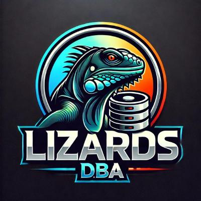

# API 4º Semestre BD

# LizardsDBA - DataGis

# Documentação - Sprint 3

      

## Desafio 

| Capacidade estimada da equipe por sprint |
| --- |
| 32 Story points |

## Sprint Goal

| Meta da sprint | Previsão da sprint |
| --- | --- |
| User stories de rank 9, 10, 11 e 12 (26 story points) | Sem user stories adicionais |

## Backlog da Sprint 3

| Rank | Prioridade | User Story | Estimativa (SP) |
| :---: | :---: | :--- | :---: |
| **9** | Baixa | **US09 (Consulta de Indicadores)**: Como Gestor, quero consultar os indicadores ambientais publicados por imóvel e por município para apoiar a avaliação socioambiental de propriedades e regiões do Paraná. | 8 |
| **10** | Baixa | **US10 (Comparação de Versões)**: Como Gestor, quero comparar versões dos indicadores de um mesmo imóvel para identificar alterações entre diferentes competências e processamentos. | 5 |
| **11** | Baixa | **US11 (Auditoria e Rastreabilidade)**: Como Auditor, quero rastrear os resultados publicados e consultar as operações que os originaram para comprovar sua procedência, integridade e responsabilidade. | 8 |
| **12** | Baixa | **US12 (Integração via API)**: Como Responsável por Integrações, quero consultar os resultados publicados por API para disponibilizá-los em outras aplicações autorizadas. | 5 |

---

## Burndown da Sprint 3 

---

## DoR e DoD por User Story – Sprint 3

### US09 (Consulta de Indicadores)

**DoR - Definition of Ready**

* [ ] **História Descrita:** A história tem um título claro e o seu objetivo de negócio é plenamente compreendido.
* [ ] **Critérios de Aceitação:** Todos os critérios de aceitação foram detalhados e acordados com a equipe.
* [ ] **Insumos de Homologação:** Versões aprovadas e publicadas na Zona Publicada (Gold) pela US08, contendo os indicadores de conservação, restrições territoriais e eventos ambientais, estão disponíveis para consulta.
* [ ] **Modelo de Dados:** O modelo de consulta por imóvel e por município (incluindo a relação entre imóvel e município do Paraná) está desenhado e homologado pelo DBA.
* [ ] **Estimativa Realizada:** O esforço de desenvolvimento foi estimado e pontuado em Story Points pela equipe.
* [ ] **Sem Dependências Bloqueadoras:** A User Story não depende de outra ainda não iniciada.
* [ ] **Compreensão Validada com a Equipe:** A equipe discutiu a história coletivamente e confirma o entendimento comum do escopo.
* [ ] **Estratégia de Testes Definida:** Os cenários de teste (unidade e integração) foram definidos previamente, alinhados à cobertura mínima exigida.

**DoD - Definition of Done**

* [ ] **Estrutura de Banco de Dados (Oracle):** Views e consultas implementadas para recuperar os indicadores publicados por imóvel e agregados por município, considerando apenas versões vigentes.
* [ ] **Backend (Spring Boot):** APIs REST desenvolvidas e documentadas (OpenAPI) para consulta por imóvel e por município, com filtros e paginação.
* [ ] **Frontend (Vue.js):** Tela de consulta com filtros por imóvel e município implementada, exibindo tabelas e gráficos (Chart.js) com os indicadores publicados.
* [ ] **Versionamento & Git:** Branch de funcionalidade (`feat/`) criada e Pull Request (PR) aberto e revisado por outro par.
* [ ] **Qualidade de Código:** Código limpo e livre de fragmentos comentados.
* [ ] **Cobertura de Testes:** Testes de unidade com cobertura mínima de 70% e testes de pipeline funcionando.

---

### US10 (Comparação de Versões)

**DoR - Definition of Ready**

* [ ] **História Descrita:** A história tem um título claro e o seu objetivo de negócio é plenamente compreendido.
* [ ] **Critérios de Aceitação:** Todos os critérios de aceitação foram detalhados e acordados com a equipe.
* [ ] **Insumos de Homologação:** Ao menos duas versões publicadas de um mesmo imóvel, referentes a competências ou processamentos distintos, estão disponíveis para teste de comparação.
* [ ] **Modelo de Dados:** A estrutura que relaciona as versões publicadas a um mesmo imóvel e às suas competências está validada com o DBA.
* [ ] **Estimativa Realizada:** O esforço de desenvolvimento foi estimado e pontuado em Story Points pela equipe.
* [ ] **Sem Dependências Bloqueadoras:** A User Story não depende de outra ainda não iniciada.
* [ ] **Compreensão Validada com a Equipe:** A equipe discutiu a história coletivamente e confirma o entendimento comum do escopo.
* [ ] **Estratégia de Testes Definida:** Os cenários de teste (unidade e integração) foram definidos previamente, incluindo casos com e sem diferenças entre versões.

**DoD - Definition of Done**

* [ ] **Estrutura de Banco de Dados (Oracle):** Consultas implementadas para calcular as diferenças entre os indicadores de duas versões de um mesmo imóvel.
* [ ] **Backend (Spring Boot):** APIs REST desenvolvidas e documentadas (OpenAPI) para listar as versões de um imóvel e retornar a comparação entre duas versões selecionadas.
* [ ] **Frontend (Vue.js):** Tela de comparação implementada, permitindo selecionar duas versões e visualizar lado a lado os indicadores, com destaque para os valores alterados.
* [ ] **Versionamento & Git:** Branch de funcionalidade (`feat/`) criada e Pull Request (PR) aberto e revisado por outro par.
* [ ] **Qualidade de Código:** Código livre de fragmentos comentados.
* [ ] **Cobertura de Testes:** Testes de unidade com cobertura mínima de 70% e testes de pipeline funcionando.

---

### US11 (Auditoria e Rastreabilidade)

**DoR - Definition of Ready**

* [ ] **História Descrita:** A história tem um título claro e o seu objetivo de negócio é plenamente compreendido.
* [ ] **Critérios de Aceitação:** Todos os critérios de aceitação foram detalhados e acordados com a equipe.
* [ ] **Insumos de Homologação:** Versões publicadas com Hash SHA-256 e registros das operações de processamento e publicação (US08) estão disponíveis para teste de rastreabilidade.
* [ ] **Modelo de Dados:** O modelo relacional para o registro de operações (quem, quando, o quê e sobre qual versão) está homologado pelo DBA.
* [ ] **Estimativa Realizada:** O esforço de desenvolvimento foi estimado e pontuado em Story Points pela equipe.
* [ ] **Sem Dependências Bloqueadoras:** A User Story não depende de outra ainda não iniciada.
* [ ] **Compreensão Validada com a Equipe:** A equipe discutiu a história coletivamente e confirma o entendimento comum do escopo.
* [ ] **Estratégia de Testes Definida:** Os cenários de teste (unidade e integração) foram definidos previamente, incluindo a verificação de integridade e a detecção de adulteração.

**DoD - Definition of Done**

* [ ] **Estrutura de Banco de Dados (Oracle):** Trilha de auditoria implementada, ligando cada resultado publicado às operações que o originaram e aos seus responsáveis.
* [ ] **Backend (Spring Boot):** APIs REST documentadas (OpenAPI) para consultar a trilha de auditoria e verificar a integridade de uma versão por meio da conferência do Hash SHA-256.
* [ ] **Frontend (Vue.js):** Tela de auditoria implementada para navegar do resultado publicado até as operações de origem, exibindo procedência, responsável e status de integridade.
* [ ] **Versionamento & Git:** Branch de funcionalidade (`feat/`) criada e Pull Request (PR) aberto e revisado por outro par.
* [ ] **Qualidade de Código:** Código livre de fragmentos comentados.
* [ ] **Cobertura de Testes:** Testes de unidade com cobertura mínima de 70% e testes de pipeline funcionando.

---

### US12 (Integração via API)

**DoR - Definition of Ready**

* [ ] **História Descrita:** A história tem um título claro e o seu objetivo de negócio é plenamente compreendido.
* [ ] **Critérios de Aceitação:** Todos os critérios de aceitação foram detalhados e acordados com a equipe.
* [ ] **Insumos de Homologação:** Versões publicadas na Zona Publicada (Gold) estão disponíveis para serem expostas aos consumidores externos.
* [ ] **Modelo de Dados:** O modelo para controle de acesso e credenciais de aplicações autorizadas está definido e homologado pelo DBA.
* [ ] **Estimativa Realizada:** O esforço de desenvolvimento foi estimado e pontuado em Story Points pela equipe.
* [ ] **Sem Dependências Bloqueadoras:** A User Story não depende de outra ainda não iniciada.
* [ ] **Compreensão Validada com a Equipe:** A equipe discutiu a história coletivamente e confirma o entendimento comum do escopo.
* [ ] **Estratégia de Testes Definida:** Os cenários de teste (unidade e integração) foram definidos previamente, incluindo acesso autorizado e não autorizado.

**DoD - Definition of Done**

* [ ] **Estrutura de Banco de Dados (Oracle):** Estruturas de credenciais e controle de acesso persistidas, permitindo expor somente resultados publicados.
* [ ] **Backend (Spring Boot):** APIs REST públicas de consulta aos resultados publicados implementadas, com autenticação de aplicações autorizadas e documentação completa (OpenAPI).
* [ ] **Frontend (Vue.js):** Tela para gerenciamento das credenciais de acesso e link para a documentação interativa da API.
* [ ] **Versionamento & Git:** Branch de funcionalidade (`feat/`) criada e Pull Request (PR) aberto e revisado por outro par.
* [ ] **Qualidade de Código:** Código livre de fragmentos comentados.
* [ ] **Cobertura de Testes:** Testes de unidade com cobertura mínima de 70% e testes de pipeline funcionando.

---

## Equipe

<table>
  <tr>
    <th>Membro</th>
    <th>Função</th>
    <th>Github</th>
    <th>Linkedin</th>
    <th>Foto</th>
  </tr>
  <tr>
    <td>Fagner Nascimento</td>
    <td>Product Owner</td>
    <td></td>
    <td></td>
    <td></td>
  </tr>
  <tr>
    <td>Flávio Pereira</td>
    <td>Scrum Master</td>
    <td></td>
    <td></td>
    <td></td>
  </tr>  
  <tr>
    <td>Benjamin Marques</td>
    <td>Desenvolvedor</td>
    <td></td>
    <td></td>
    <td></td>
  </tr> 
  <tr>
    <td>Brenda Bettini</td>
    <td>Desenvolvedor</td>
    <td></td>
    <td></td>
    <td>
  </td>
  </tr> 
    <tr>
    <td>Cauã Mohor</td>
    <td>Desenvolvedor</td>
    <td></td>
    <td></td>
    <td></td>
  </tr> 
  <tr>
    <td>Lucas Castro</td>
    <td>Desenvolvedor</td>
    <td></td>
    <td></td>
    <td></td>
  </tr>
  <tr>
    <td>Luiz Gustavo</td>
    <td>Desenvolvedor</td>
    <td></td>
    <td></td>
    <td></td>
  </tr>
  <tr>
    <td>Matheus de Paula</td>
    <td>Desenvolvedor</td>
    <td></td>
    <td></td>
    <td></td>
  </tr>
</table>
